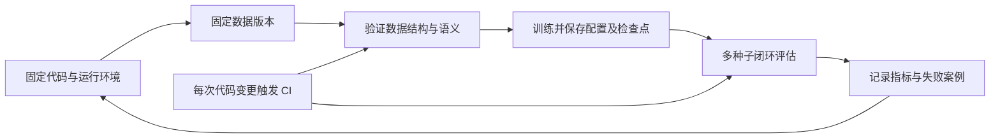

# 第 9 章｜RobOps 实践：可复现环境、数据验证与策略评估

> **依据习题拓展**：本章对应 `homework/9.ipynb`，资料中没有对应课件。以下原理、流程和例子围绕五道习题编写，不代表缺失课件的原文。参考答案为推导结果。

## 1. 把一次实验变成可复现的流程

机器人运维（RobOps）把代码、环境、数据、策略与运行结果连接起来。一次“训练成功”至少需要回答：使用哪份数据、哪个版本的程序、怎样的运行环境、哪些训练参数，以及评估时实际执行了什么策略。

**补充解释**：可以把实验身份写成一个元组：

$$
\mathcal E=(c,d,r,i,\theta,h,s,e),
$$

其中 $c$ 是代码提交，$d,r$ 是数据集标识与版本，$i$ 是环境镜像标识，$\theta$ 是模型检查点，$h$ 是超参数与预处理配置，$s$ 是随机种子集合，$e$ 是硬件和评估环境配置。只记下“用了 ACT”或“成功率 80%”，无法重建实验；模型相同而归一化统计量、动作频率不同，也可能执行出完全不同的动作。



“可复现”也有不同强度：能够重新运行流程、指标在合理误差内一致、输出逐位相同，是三个不同目标。随机算法、并行归约的浮点运算顺序、驱动和硬件差异，都可能影响最后一种目标。

## 2. Docker：定义环境，而不是消除环境管理

容器（container，コンテナ）是隔离的运行进程；镜像（image，イメージ）是创建容器的文件系统和运行配置。Dockerfile 描述镜像构建步骤，镜像则可用于启动多个可删除、可重建的容器。容器共享宿主侧的内核；虚拟机（virtual machine，仮想マシン）通常具有自己的客户操作系统内核。[Docker 官方说明](https://docs.docker.com/get-started/docker-concepts/the-basics/what-is-a-container/)

| 对象 | 应当固定什么 | 对机器人实验的影响 |
|---|---|---|
| 用户空间 | 基础镜像、Python、系统库、依赖版本 | 决定程序能否导入、编译和运行 |
| 数据与配置 | 数据版本、挂载路径、配置文件 | 镜像一样不代表输入一样 |
| 硬件接口 | GPU、设备权限、驱动兼容性 | 容器需要访问实际存在的硬件 |
| 模型接口 | 检查点、归一化、动作维度与单位 | 程序启动成功不等于策略行为正确 |

**补充解释**：镜像中的“OS 环境”主要指发行版用户空间及其库，并不意味着在容器中独立模拟了整个硬件系统。macOS 上的 Docker Desktop 运行 Linux 容器还涉及承载它的 Linux 虚拟机。[Docker Desktop 虚拟化说明](https://docs.docker.com/desktop/features/vmm/)Docker 不会凭空生成 GPU；GPU 训练还需要真实设备及相应的宿主驱动和容器访问配置。

依赖仍然要管理。写 `pip install some_package` 而不固定版本，每次重建可能获取不同依赖；仅固定直接依赖也未必固定间接依赖。记录基础镜像摘要和锁定后的依赖，有助于把“相似环境”变成可追溯环境。

> **补充操作示例，仅供阅读**：下面展示镜像与容器的关系，不是课程原始命令，也不会在此执行。
>
> ```bash
> docker build -t robops-study:local .
> docker run --rm -v "$PWD/data:/workspace/data:ro" robops-study:local
> ```
>
> 第一行以当前目录的 Dockerfile 和构建上下文生成命名镜像。第二行从镜像启动容器，`--rm` 表示退出后删除该容器，`-v` 将宿主 `data` 挂载到容器目录，`:ro` 表示只读。前提是 Docker 已可用、Dockerfile 存在、镜像有合适的启动入口；预期结果是入口程序在定义的环境内运行，而不是自动训练或获得 GPU。

## 3. 数据版本：让实验指向同一份输入

数据集标识（dataset ID）回答“哪一个仓库”，版本（revision，リビジョン）回答“该仓库的哪一个状态”。Hugging Face Hub 默认下载主分支的当前内容，也支持用分支名、标签或完整提交哈希指定 revision。要固定不可变的历史状态，完整提交哈希比会继续移动的分支名更明确。[Hugging Face 下载指南](https://huggingface.co/docs/huggingface_hub/guides/download)

> **补充操作示例，仅供阅读**：
>
> ```python
> from huggingface_hub import snapshot_download
>
> dataset_path = snapshot_download(
>     repo_id="organization/robot_dataset",  # 替换为实际仓库
>     repo_type="dataset",                  # 指定数据集而非模型仓库
>     revision="<完整提交哈希>",            # 替换为已记录的版本
> )
> ```
>
> 前提是对应仓库存在且具有访问权限，必要时已配置认证。该调用取得指定版本的仓库快照并返回本地路径；下载缓存能减少重复传输，但不会自动清洗数据、划分训练集或验证动作单位。

**补充解释**：版本固定还应延伸到派生数据。若原始图像不变，但裁剪、重采样或动作归一化算法变了，训练输入仍然变了。因此应同时保存：原始数据版本、处理代码版本、处理参数、划分索引和归一化统计量。机器人序列通常按完整 episode 划分训练与验证，避免相邻帧分到两边，使验证看起来过于容易。

## 4. Validator：验证数据，也验证验证器

验证器（validator，バリデータ）检查数据是否满足明确的约束。它输出“通过”或具体错误；修复器负责如何改动数据，两者不是同一职责。

**补充解释**：机器人数据验证可从结构逐步深入到语义：

| 层次 | 典型约束 | 能发现的问题 |
|---|---|---|
| 文件与模式 | 必需文件、字段、类型、数组形状存在且一致 | 缺相机字段、动作长度错误、文件损坏 |
| 数值 | 有限值、合理范围、明确单位 | NaN、无穷、米与毫米混用 |
| 时间与序列 | episode 边界正确、时间单调、采样同步 | 跨 episode 拼接、逆序时间戳、图像与动作错位 |
| 机器人语义 | 关节顺序、坐标系、夹爪含义符合约定 | 左右关节交换、姿态表示错误、开合符号反了 |
| 任务语义 | 标签和动作确实对应目标 | “抓取成功”标签与实际画面不符 |

形状正确是必要条件，但不能证明语义正确。例如六维动作可能是六个关节角，也可能是末端三维平移加三维旋转；两者都能通过“长度为六”的检查，却不能互换。

验证器自身需要正例与反例：正确的小数据集应通过；有意删除字段、插入 NaN、交换时间顺序或改变动作维度，应被对应规则拒绝。每次只破坏一个约束，更容易定位某条规则是否真正生效。

$$
\mathrm{FPR}=\frac{\text{正常样本被误判为异常}}{\text{全部正常样本}},\qquad
\mathrm{FNR}=\frac{\text{异常样本被漏判为正常}}{\text{全部异常样本}}.
$$

这里的假阳性率 FPR 和假阴性率 FNR 衡量的是异常检测。一直返回“失败”的验证器可能没有漏报，却无法接受正常输入；一直返回“成功”的验证器完全失去检测能力。刻意构造坏数据是在测试验证器，不是在把坏数据当作模型的验证集。

自动检查无法穷尽语义错误。针对异常 episode 回看原始图像、轨迹和时间轴，仍是判断单位、任务标签与动作合理性的有力方法。检查失败后应定位问题并明确修复规则，不能为了让验证通过而直接删除所有失败记录。

## 5. 策略评估：从预测误差走向闭环任务能力

策略（policy，ポリシー）根据观察产生动作，动作又改变下一时刻的观察。因此机器人评价是闭环（closed loop，閉ループ）过程。

**补充解释**：以行为克隆（behavior cloning，行動模倣）为例，训练目标可能是

$$
L_{\mathrm{BC}}(\theta)=\frac1N\sum_{i=1}^{N}\|\pi_\theta(o_i)-a_i\|_2^2.
$$

它衡量专家数据中的观察 $o_i$ 上，预测动作与示范动作 $a_i$ 的差异。真实执行时，小误差改变状态，下一次观察可能偏离训练分布；连续误差使策略进入示范中少见的状态。训练或验证损失下降，并不能单独推出任务成功率上升。对于扩散、流模型或离散动作预测，损失定义还可能完全不同，更不能跨模型直接比较损失数值。

合理的评估固定一组种子（seed，乱数シード），让不同模型面对可比较的初始状态与任务扰动；同时使用多个种子和多个 episode，避免结论只由一个幸运场景决定。需要统一模拟器版本、动作解释、控制频率、任务成功判据和超时规则。

| 指标 | 说明 | 常见误读 |
|---|---|---|
| 累计奖励 $G=\sum_{t=0}^{T-1}\gamma^t r_t$ | 按任务奖励定义汇总过程表现 | 奖励增加未必意味着任务完成 |
| 成功率 $\hat p=k/n$ | $n$ 次试验中成功 $k$ 次 | 不同成功判据与样本数不可直接比较 |
| 完成时间/步数 | 成功所需控制成本 | 只统计成功试验会隐藏大量失败 |
| 碰撞、越界和失败类别 | 执行行为的约束与原因 | 一段漂亮视频不能代表全部试验 |

若试验近似独立，成功率的标准误差可粗略写成 $\sqrt{\hat p(1-\hat p)/n}$；样本少时不宜把百分之几的变化当成稳定提升。固定种子有助于重复比较，但最终还应考察新的场景和扰动，否则也可能过度适配这组测试。

“回放数据”展示的是记录中的专家行为；“执行策略”需要策略实时读取观察、输出动作，并由环境生成后续状态。二者是不同的评估对象。视频用于解释典型失败和动作过程，汇总指标用于判断总体性能。

## 6. CI：把必要检查放进每次变更

持续集成（continuous integration，継続的インテグレーション，CI）让代码变更触发一致的自动检查，尽早发现回归。GitHub Actions 以事件触发工作流（workflow），工作流包含作业（job），作业在运行器（runner）上执行步骤（step）。[GitHub Actions 官方概述](https://docs.github.com/en/actions/get-started/understand-github-actions)

**补充解释**：RobOps 的 CI 可以从便宜、明确的检查开始：代码语法及单元测试 → 正常/损坏数据验证器测试 → 小规模模拟器运行检查。小测试回答“接口和基本行为有没有被改坏”，完整策略评价回答“性能是否可靠”，长期训练则是另一个成本更高的工作流。

> **补充配置示例，仅供阅读**：以下展示 CI 的结构，文件路径和验证脚本为示意；不能直接视为课程仓库配置。
>
> ```yaml
> name: dataset-check
> on: [push, pull_request]
> permissions:
>   contents: read
> jobs:
>   validate:
>     runs-on: ubuntu-latest
>     steps:
>       - uses: actions/checkout@v7
>       - name: Validate good and intentionally broken fixtures
>         run: python3 tests/test_dataset_validator.py
> ```
>
> `on` 指定触发事件，`jobs` 定义作业，`runs-on` 选择运行器，`steps` 按顺序运行。`checkout` 取出当前变更对应的代码；官方仓库目前示例使用 v7，该写法是经核实的补充，而非课件原命令。[checkout 官方仓库](https://github.com/actions/checkout)
>
> 前提是测试脚本存在且所需环境已配置；示意中脚本应能在标准运行器上运行。预期结果是通过/失败状态与日志，测试失败应以非零退出码向 CI 报告。

CI 不会自动加密仓库、替代 Git 提交、提供不存在的 GPU，或自动把策略部署到真实机器人。训练和部署可以另建工作流，但它们的权限、计算资源、触发条件与验证目标需要单独定义，不能仅凭“启用了 GitHub Actions”推断这些行为。

## 7. 习题与逐项解析

### Q1｜Docker 开发环境的优势

使用 Docker 构建开发环境，以下哪一项最恰当？

- **A** 使用 Docker 后，无需管理依赖包的版本。
- **B** Docker 能复制物理 GPU，因此没有 GPU 的电脑也能进行 GPU 训练。
- **C** 已创建的容器无法删除，因此可以保护运行环境。
- **D** 使用 Docker 后，不同操作系统上保证获得完全相同的计算结果。
- **E** 可以定义包含操作系统环境和依赖包的运行环境，使其他电脑更容易重现相同条件。

**提示**：区分“固定软件环境”“提供物理硬件”和“数值结果完全一致”。

**参考答案：E。**

- **A 错误**：Docker 把依赖安装过程写入环境定义，但版本仍需人为明确。若使用浮动基础镜像或不锁定依赖，重新构建仍可能得到不同环境。
- **B 错误**：容器隔离进程并暴露可用硬件，不模拟出物理 GPU。GPU 训练需要真实 GPU、合适驱动和访问配置；CPU 运行同一算法也不能称为获得了 GPU。
- **C 错误**：容器可以停止、删除和重建，这正是容器工作流的重要特点。需要长期保存的数据应明确放在挂载或持久存储中，而不是假设容器不能删除。
- **D 错误**：一致的用户空间能减少环境差异，但不能消除硬件、内核、驱动、随机性和浮点执行顺序的影响。“更容易复现运行条件”不等于“保证逐位一致”。
- **E 正确**：镜像能描述和分发依赖及用户空间，降低在不同机器上手工重建环境的成本。其中“OS”应理解为相关用户空间环境；还需记录宿主硬件和驱动等条件。

### Q2｜为什么记录数据集 ID 与 revision

从 Hugging Face Dataset Hub 获取数据时，记录数据集 ID 和 revision 的主要理由是什么？

- **A** 自动修正数据集中的异常值。
- **B** 确定使用的数据集及其版本，以便重新获取相同数据。
- **C** 自动将数据集划分为训练集和验证集。
- **D** 必定缩短数据下载时间。
- **E** 使数据集只能通过 GitHub Actions 获取。

**提示**：ID 定位仓库，revision 定位仓库状态。

**参考答案：B。**

- **A 错误**：版本信息只确定哪些文件被读取，不判断数值是否异常。异常处理需要验证规则及明确的修复或排除流程。
- **B 正确**：ID 与版本共同指向实验输入，能够追踪并重新取得对应状态。若希望长期固定数据，应记录完整提交哈希，而不是只记录可能移动的分支名。
- **C 错误**：训练/验证划分是独立的数据处理决策。版本可记录已存在的划分，但记录版本本身不会自动产生划分，也不会防止序列泄漏。
- **D 错误**：缓存和增量传输可能减少下载，但速度还取决于文件大小、网络和缓存状态。记录 revision 的主要价值是可追溯性，无法保证下载更快。
- **E 错误**：同一数据版本可由本地程序、服务器或 CI 下载，访问由权限和接口决定。revision 不会把访问渠道限定为 GitHub Actions。

### Q3｜怎样验证验证器

为什么要用正常数据和有意损坏的数据，两者都检查数据集 validator？

- **A** 把正常数据用于训练，损坏数据用于模型验证。
- **B** 用损坏数据提高策略性能。
- **C** 证明无需人工目视检查数据集的全部记录。
- **D** 确认 validator 能让正常数据通过，并检测异常数据。
- **E** 因为运行 validator 后，损坏的数据会自动修复。

**提示**：被测试的对象是验证器，不是策略。

**参考答案：D。**

- **A 错误**：这里正常与损坏数据是验证器的测试用例，并不是机器学习的训练/验证划分。把损坏数据直接作为模型验证集，反而可能失去有意义的性能评估。
- **B 错误**：人为破坏记录主要用于确认检查规则是否生效。具有任务意义且标签仍正确的数据增强可能有助于训练，但缺字段、错误维度和 NaN 不是这种增强。
- **C 错误**：通过测试只能证明验证器处理了已设计的用例，不能证明涵盖所有语义错误。自动检查能减少人工工作，但对标签、单位和任务成功的判断仍可能需要抽查与可视化。
- **D 正确**：两类输入同时检查接受能力和拒绝能力，能够暴露误报与漏报。仅测正常数据发现不了“所有输入都通过”，仅测异常数据发现不了“所有输入都失败”。
- **E 错误**：验证器通常报告违反规则的位置和原因，不负责自动修改数据。修复必须另行定义，否则“自动修复”可能掩盖真实数据问题。

### Q4｜怎样评估策略

关于策略评价，以下哪项最恰当？

- **A** 训练损失下降，策略在模拟器中就会完成任务。
- **B** 验证损失低，就无需进行模拟器评价。
- **C** 除损失外，还用固定的多个种子运行模拟器，检查奖励和成功率。
- **D** 仅使用最成功的一段视频评价策略。
- **E** 再回放一次训练用数据集，就能评价策略的任务性能。

**提示**：离线预测误差和策略改变环境后的闭环表现，是不同指标。

**参考答案：C。**

- **A 错误**：训练损失反映策略对已见数据的拟合，可能随过拟合持续下降。执行误差会改变之后的观察，策略因此可能在模拟器中失败。
- **B 错误**：验证损失比训练损失更能反映未见示范上的预测表现，但仍不是闭环任务成功的直接测量。必须观察策略实际行动产生的后果。
- **C 正确**：多个固定种子使模型面对可重复、较多样的条件；奖励与成功率补充损失无法描述的任务表现。应报告试验次数、统一判据和汇总结果，而不是只展示最佳一次。
- **D 错误**：选择最佳视频有明显的选择偏差，无法知道其余试验是否失败。视频适合展示行为与分析失败，应和全部试验的统计一起使用。
- **E 错误**：回放训练数据执行的是记录中的动作，并没有检验策略自行决策后的状态变化。只有让策略控制环境，才能测量它完成任务的能力。

### Q5｜GitHub Actions 的 CI 目的

使用 GitHub Actions 开展 CI，主要目的是什么？

- **A** 每次 push 都自动执行相同验证，检查变更是否破坏原有处理。
- **B** 加密 GitHub 上的代码，使其他用户无法看到。
- **C** 高效使用 GPU，加速策略训练。
- **D** 不用 Git commit，也能管理变更历史。
- **E** 自动将已训练策略部署到真实机器人。

**提示**：区分持续集成、训练调度、访问权限和部署。

**参考答案：A。**

- **A 正确**：按配置事件运行一致检查，有助于及时发现接口、数据处理或基础行为的回归。题目说“每次 push”是典型配置，实际触发范围仍由工作流定义。
- **B 错误**：仓库可见性和访问权限属于 GitHub 仓库管理，不是 CI 的核心功能。执行自动测试不会自动隐藏或加密代码。
- **C 错误**：工作流能够调度已配置的计算资源，但 CI 的主要目标是验证变更。GPU 的有无及训练效率取决于运行器和训练实现，启用 Actions 本身不保证这些条件。
- **D 错误**：Git 提交记录代码历史，CI 通常针对某个提交执行检查。自动验证不替代提交，也不能在没有明确版本身份的情况下提供同等追溯能力。
- **E 错误**：部署属于另一个流程；CI 通过不等于允许真实机器人执行。是否部署取决于专门的触发、资源及验证安排，不能从“使用 CI”直接推出自动部署。
