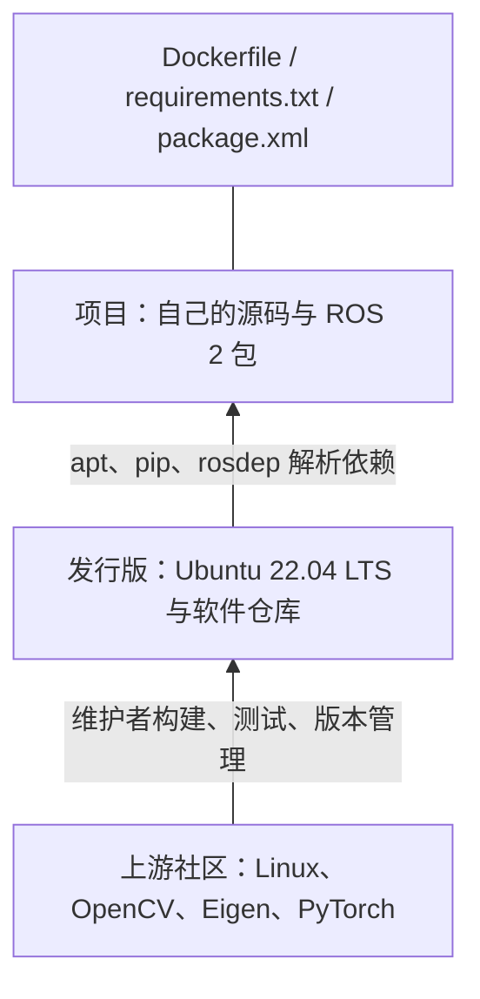
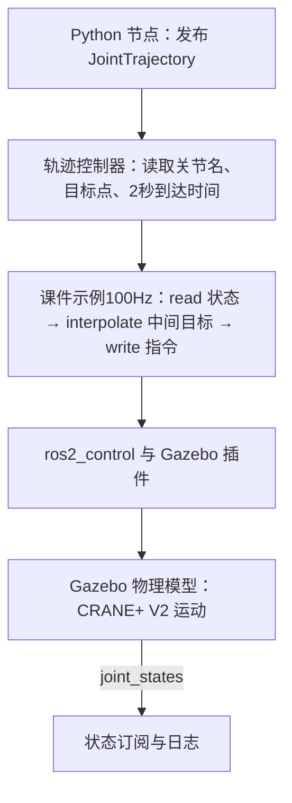

# 第 11 章｜软件包与 ROS 2：从依赖管理到机器人通信

主版本：Mac 本地：`pdfs/11.pdf`；旧版本：Mac 本地：`pdfs/12.pdf`；习题：Mac 本地：`homework/11.ipynb`。本章把“别人写好的功能如何装进项目”和“各功能如何在运行时交换数据”连起来。2025 版的重复知识与版本差异集中在“旧版补充”中；习题答案由课件、接口定义和原论文推导，没有官方答案键。

## 1. 软件包：把可复用代码变成可管理的依赖

### 1.1 社区、发行版与项目是三个不同层次

> 来源：11.pdf · 第 9、17 页。

打包（packaging／パッケージング）不只是把文件压缩在一起，还要描述版本、依赖、安装位置与维护方式。机器人项目同时依赖驱动、数学库、视觉库、控制算法和学习框架，手动复制文件很难保证这些部件仍然匹配。



上游（upstream）通过 GitHub、GitLab、Kernel.org 等维护源码，以 issue、PR 和 CI 协作；发行版维护者把适用版本构建成包，再通过仓库分发。课件图中的 Security、Backports、PPA 是不同更新/分发渠道，不能仅因都能被 APT 访问就认为来源与版本策略相同。项目层用声明文件记录需要什么，再交给工具解析。

ROS 将驱动、感知、导航、操作和工具按包分发，降低重复实现成本。课件引用的历史调查图列出 RViz、navigation、MoveIt、tf、rqt、OpenNI、Gazebo、PCL、roscpp、rosbag、OpenCV 等部件；它表达的是系统依靠多个现成功能组合，不是当下的技术排名。

### 1.2 `.deb`、`dpkg` 与 APT 各自做什么

> 来源：11.pdf · 第 10–14 页。

Debian/Ubuntu 常用 `.deb` 分发安装包；本课 ROS 2 环境也以 Ubuntu LTS 为基础。可以把 `.deb` 类比为安装用的“部件箱”，但它不同于一个直接双击执行的通用 `.exe`。

| 对象 | 保存或负责的内容 | 直观理解 |
|---|---|---|
| `.deb` | 控制元数据与待安装文件 | 一个可分发的安装部件 |
| `control` 等控制信息 | 包名、版本、维护者、依赖，以及可能的维护脚本 | 部件的说明书与安装要求 |
| `data.tar.*` | 程序、库、配置等实际文件 | 要放进系统中的内容 |
| `dpkg` | 对本地包解包、配置，维护已安装状态 | 具体执行安装工作的底层工具 |
| APT（Advanced Packaging Tool） | 仓库索引、版本选择、递归依赖解析、下载，再调用 `dpkg` | 决定还缺哪些部件，并安排安装 |

**勘误**：源页“程序与所有必要库装进一个文件”过于笼统。一个 `.deb` 可以包含程序或库，但其依赖通常由其他包提供，在 `Depends` 等字段中声明，再由 APT 安装；不要求把依赖全部塞进同一文件。实际 `.deb` 还含格式版本成员 `debian-binary`、控制归档 `control.tar.*` 和数据归档 `data.tar.*`。[Debian 包格式](https://manpages.debian.org/bookworm/dpkg-dev/deb.5.en.html)

APT 的信任检查也应理解准确：通常验证仓库 Release 元数据的签名，再沿索引中的校验和核对下载包；不是默认逐一验证每个 `.deb` 的独立维护者签名。这能验证来源链与传输完整性，不等于证明程序没有漏洞。[APT 官方安全说明](https://manpages.debian.org/bookworm/apt/apt-secure.8.en.html)

> **课件命令速查，仅作学习材料，不在此执行。** 前提是 Debian/Ubuntu 系统或对应容器，已配置可访问的仓库；修改系统包需要相应权限，`sudo` 用于提权。`<package_name>`、`<key_word>` 是待替换占位符。
>
> | 命令 | 用途与预期结果 |
> |---|---|
> | `sudo apt update` | 下载最新包列表并更新本地索引；不安装这些更新。 |
> | `sudo apt install <package_name>` | 解析依赖、下载并安装指定包及所需依赖。 |
> | `sudo apt upgrade` | 根据已配置仓库升级已安装包；不是只升级某一个指定包。 |
> | `sudo apt remove <package_name>` | 删除包，通常保留其系统配置文件。 |
> | `sudo apt purge <package_name>` | 删除包及其受包管理器管理的配置；不等于删除用户主目录里所有相关数据。 |
> | `sudo apt autoremove` | 删除被标记为自动安装且已不再需要的依赖；应阅读候选清单。 |
> | `apt search <key_word>` | 按本地索引搜索包。 |
> | `apt show <package_name>` | 查看版本、维护者、依赖、描述等元信息。 |

**补充解释**：`upgrade` 的“最新”是当前仓库与约束允许的版本，不是上游任意最新版本；需要删除现有包才能完成的升级会被保留。`update` 只是刷新“商品目录”，`upgrade` 才更换已安装部件。[APT 官方手册](https://manpages.debian.org/bookworm/apt/apt.8.en.html) 安全补丁同样需要安装相应更新，也可由配置好的自动更新工具完成。[unattended-upgrades 官方手册](https://manpages.debian.org/bookworm/unattended-upgrades/unattended-upgrade.8.en.html)

课件用 Rust 工具包演示如何读日志：

> ```bash
> sudo apt update
> apt search rust-all
> sudo apt install rust-all
> apt show rust-all
> # 课件演示后的可选清理
> sudo apt purge rust-all && sudo apt autoremove
> ```
>
> `&&` 表示前一步成功后才执行后一步。截图安装命令还使用 `-y` 自动回答确认；正文未加该选项。`rust-all` 是演示对象，也可用课件列出的 `x11-apps` 体会查询流程。

第 13 页日志显示新增 9 个包、约 104 MB 下载、约 411 MB 新磁盘占用；它是课件环境的历史实例。新增列表包括 `rustc`、`cargo`、`rustfmt`、`rust-clippy`、`rust-gdb`、`rust-lldb` 和相关库，说明安装一个名字会触发依赖解析。第 14 页中 `Depends` 是依赖约束，`Recommends` 是推荐关系，`Suggests` 是更弱的建议；`Installed-Size` 与 `Download-Size` 分别描述安装占用与压缩包下载量，不能混用。日志里的“可升级 632 个”也不是已经升级完成。

APT 按仓库配置获取索引；课件举 `/etc/apt/sources.list`，并说明经 HTTP/FTP 下载、递归查找依赖、调用 `dpkg` 展开并执行配置脚本，最后更新状态数据库。故“包管理”既包含获取文件，也包含系统状态的持续维护。

### 1.3 OS、语言环境与容器管理的是不同范围

> 来源：11.pdf · 第 15–16 页。

| 层次 | 课件列出的工具 | 管理重点 |
|---|---|---|
| 发行版／系统 | APT（Debian/Ubuntu）、Homebrew（macOS/Linux） | 系统程序、编译器、共享库等 |
| Python | pip、课件列出的 pyPM | Python 包与依赖 |
| C/C++ | Conan、vcpkg | C/C++ 库与构建依赖 |
| Rust | Cargo | Rust 包与构建 |
| 项目环境 | uv、Pixi | 项目之间的版本隔离与可复现依赖 |

uv 是 Rust 实现的 Python 包与项目管理工具，覆盖 pip/pip-tools 一类工作流并支持项目虚拟环境。Pixi 基于 Conda 生态的二进制包与环境能力，可组织 Python、C++、Rust、ROS 2 等多语言依赖；课件说明其集成 uv 处理 Python 包。`pixi install` 根据项目声明建立/安装环境。虚拟环境隔离的是项目依赖，不意味着拥有独立内核或对所有系统资源完全隔离。

容器把应用和所需用户空间文件组成镜像（image／イメージ），由 Docker 等运行时启动成容器（container／コンテナ）：


镜像便于分发一致的软件环境，标签便于标识版本；它能减少与宿主软件冲突。**补充解释**：课件的“应用＋OS”主要指用户空间，并非每个容器各有完整内核；同一 Linux 宿主上的容器共享内核，硬件、架构和驱动仍影响运行。[Docker 官方解释](https://docs.docker.com/get-started/docker-concepts/the-basics/what-is-a-container/)

### 1.4 本课的 Docker 桌面环境

> 来源：11.pdf · 第 2、6 页。

课程使用《ROS 2 与 Python AI 机器人入门》配套的 ROS 2 Humble 桌面镜像，后续命令在这个 Linux 环境里阅读和理解。

> **原课件准备命令，镜像名因排版产生的换行已合并；不执行：**
>
> ```bash
> docker pull airobotbook/ros2-desktop-ai-robot-book-humble:latest
> docker run -p 6080:80 --shm-size=512m airobotbook/ros2-desktop-ai-robot-book-humble:latest
> ```
>
> 前提是 Docker 已安装且运行。`pull` 下载镜像；`run` 由该镜像创建并启动实例；`-p 6080:80` 把宿主 6080 端口映射到容器 80 端口；`--shm-size=512m` 配置共享内存区域容量。浏览器打开 `http://localhost:6080/`，在 noVNC 页面点击“连接”，预期看到容器桌面。

`latest` 是镜像标签，不能据标签推断它永远指向同一内容。此处不额外替换课程镜像、启动参数或 ROS 发行版；需要记录训练环境时，可继续参考第 10 章的系统与容器知识。

## 2. ROS 2：让异步部件组成机器人系统

### 2.1 节点与四层能力

> 来源：11.pdf · 第 19–21 页。

ROS（Robot Operating System）是机器人软件的中间件（middleware），负责组件开发与集成；它不是负责进程调度、内存管理的 Linux/macOS/Windows 内核。课件把其作用概括为：

| 能力 | 解决什么 |
|---|---|
| Plumbing（通信基础／通信） | 将分布式计算部件连接起来，交换类型明确的数据 |
| Tools（工具群／ツール群） | 配置、启动、监视、调试、可视化、日志、测试与停止 |
| Capabilities（功能库／機能群） | 导航、机械臂操作、感知等现成功能 |
| Ecosystem（生态／エコシステム） | 驱动和软件包的共享、维护与复用 |

机器人天然是异步分布式系统：RGB 相机约 30–60 Hz，力传感器约 1000 Hz，控制约 100–1000 Hz。感知不断更新环境信息，决策从数据计算下一步关节角或末端位姿，执行器跟踪指令；三者不必同步等待在同一个循环中。ROS 让它们以多个程序、不同语言开发，并通过通信协作。

节点（node／ノード）是参与 ROS 图的功能单元，例如相机节点、控制节点、记录节点。课件把节点称为“运行中的程序”；**补充解释**：这是入门简化，一个进程也可以包含多个节点，不能把节点数直接当成进程数。[ROS 2 节点定义](https://github.com/ros2/ros2_documentation/blob/humble/source/Concepts/Basic/About-Nodes.rst)

### 2.2 四种通信：按交互关系选择

> 来源：11.pdf · 第 21–26 页。

| 接口 | 核心关系 | 适用场景 |
|---|---|---|
| 话题 topic／トピック | 发布—订阅，持续、异步的数据流 | 图像、关节状态、控制目标，多个消费者共享传感器 |
| 服务 service／サービス | 请求 request—响应 response | 快速状态查询、开关与模式切换 |
| 动作 action／アクション | 目标 goal—反馈 feedback—结果 result | 耗时运动、导航，需要进度或取消的任务 |
| 参数 parameter／パラメータ | 命名配置值的读取、修改与变化通知 | PID 增益、检测阈值等运行配置 |

话题像广播频道：发布者（publisher／パブリッシャ）把消息（message／メッセージ）送到话题，订阅者（subscriber／サブスクライバ）选择自己要接收的频道。一个话题可有多个发布者和订阅者，发送者无需逐个调用接收者。消息有类型，例如 `std_msgs` 的简单类型、`geometry_msgs` 的几何量、`sensor_msgs` 的传感器量；也能定义自己的双臂状态或触觉消息。双方遵守同一接口，Python 发布者就能与 C++ 订阅者通信。

服务的客户端（client）发送请求，服务端（server）处理并返回响应，一次交互对应一项请求结果；多个客户端可以访问同一服务。课件用搜索查询、回初始姿态作类比。**勘误**：服务并非只能同步阻塞，`rclpy` 也提供 `call_async()`；若运动耗时且需要反馈或取消，action 更合适。同步 `call()` 阻塞当前线程，在负责处理响应的回调中错误使用可能死锁。[ROS 2 官方同步/异步客户端说明](https://github.com/ros2/ros2_documentation/blob/humble/source/How-To-Guides/Sync-Vs-Async.rst)

> 原课件图仅在 Mac 本地：`assets/11/action-communication.png`

图中 action client 向 goal service 发目标，server 执行时通过 feedback topic 报告进度，完成后通过 result service 返回结果；因此 action 同时组合服务和话题。**补充解释**：完整 action 接口还支持取消目标和状态管理，图只画出理解流程所需的主要通路。[ROS 2 Action 定义](https://github.com/ros2/ros2_documentation/blob/humble/source/Concepts/Basic/About-Actions.rst) 不要把“机器人动作”这个普通词与 ROS action 接口混淆：本章末尾的机械臂动作实际上通过 topic 发送。

参数是节点保存的命名值，例如 PID 的比例增益或 `score > 0.6` 中的阈值。Get/Set 通过服务读取或修改，parameter event topic 异步通知变化；因此课件称它“同步通信”只概括读写操作，不代表所有参数事件都同步发生。参数改变能否立即影响控制，还取决于节点如何校验并应用这个值。

### 2.3 用 CLI 观察通信，而不只看机器人是否移动

> 来源：11.pdf · 第 23、27 页。

> **原课件话题演示命令，不执行。** 前提是 ROS 2 环境已加载，`demo_nodes_py`、`demo_nodes_cpp` 等包可发现；长时间运行的节点放在不同终端。
>
> ```bash
> ros2 run demo_nodes_py talker
> ros2 run demo_nodes_py listener
> ros2 run demo_nodes_cpp listener
> ros2 topic list
> ros2 topic type /chatter
> rqt_graph
> ```
>
> `ros2 run <包> <可执行程序>` 启动节点。talker 在 `/chatter` 发布 `Hello World: {count}`；两个 listener 分别用 Python/C++ 接收。`list` 显示话题名，`type /chatter` 预期为 `std_msgs/msg/String`；`rqt_graph` 可视化节点—话题连接，帮助确认谁向谁发数据。

> **原课件 turtlesim 演示命令，不执行：**
>
> ```bash
> ros2 run turtlesim turtlesim_node
> ros2 run turtlesim turtle_teleop_key
> ros2 topic list
> ros2 topic echo /turtle1/cmd_vel
> ros2 topic type /turtle1/cmd_vel
> ros2 topic echo /turtle1/rotate_absolute/_action/feedback
> ```
>
> 第一个节点显示海龟，第二个节点接收键盘遥操作。方向键经话题控制平移/转动；G、B、V、C、D、E、R、T 键经 action 控制旋转。`echo` 持续显示收到的消息，`type` 查看接口类型；最后一条观察 action 的中途反馈。

**补充解释**：`/turtle1/cmd_vel` 传递的是 `geometry_msgs/msg/Twist` 速度指令，平面任务主要用 `linear.x` 和 `angular.z`。[Humble 遥操作节点源码](https://github.com/ros/ros_tutorials/blob/humble/turtlesim/tutorials/teleop_turtle_key.cpp) 查看 topic 名、类型、内容和连接是四种不同诊断；“有这个话题”并不能单独证明消息正在到达或控制器接受了它。

### 2.4 习题所涉及的 ROS 设计理念

> 来源：homework/11.ipynb · Q5；补充解释依据所指定的 2009 年原论文。

原论文列出五项 philosophical goals：Peer-to-peer、Tools-based、Multi-lingual、Thin、Free and Open-Source。对等数据连接减少中心转发瓶颈；小工具组合便于调试；语言无关消息支持多语言；Thin 指将算法尽量写为独立库，仅用薄 ROS 层接入；开放源码利于检查与复用。早期 ROS 的 master 用于名字发现，并不意味着所有消息必须经中心服务器转发。这些是原论文的设计原则，不应直接用旧版实现细节解释 ROS 2。[Quigley 等，2009，原论文 §II](https://ai.stanford.edu/~ang/papers/icraoss09-ROS.pdf)

## 3. 工作空间与 Python 包：源码怎样变成可启动节点

### 3.1 目录结构与包元数据

> 来源：11.pdf · 第 28–33 页。

工作空间（workspace／ワークスペース）集中存放源码与构建结果，包（package／パッケージ）是组织与分发单位；一个包可包含多个节点、库、配置或消息定义。

```text
pai_ws/
├── src/       # 源码包
├── build/     # 构建中间结果
├── install/   # 安装结果与环境设置脚本
└── log/       # 构建日志

src/test_pkg/
├── package.xml
├── resource/test_pkg
├── setup.py
├── setup.cfg
├── test/
│   ├── test_copyright.py
│   ├── test_flake8.py
│   └── test_pep257.py
└── test_pkg/__init__.py
```

`package.xml` 是包清单（manifest），声明 `name`、`version`、`description`、`maintainer`、`license` 和依赖。源图使用 package format 3，示范版本 `0.0.0`，并列出 `ament_copyright`、`ament_flake8`、`ament_pep257`、`python3-pytest` 测试依赖，以及导出的构建类型 `ament_python`。这些测试分别涉及版权、代码风格、文档字符串和 Python 测试；自动生成的 TODO 不是正式包描述。

`setup.py` 是 Python 打包与安装配置：`find_packages(exclude=['test'])` 找 Python 包；`data_files` 安装 resource 标记和 `package.xml`；`install_requires=['setuptools']` 声明相应 Python 安装依赖；版本、作者、描述、许可证和测试要求也在其中。`setup.cfg` 辅助设置安装位置，`resource/test_pkg` 供包索引识别，`__init__.py` 标识 Python 包。

ROS 节点入口要注册在 `entry_points` 的 `console_scripts` 中。**补充解释**：例如下面把命令名 `talker` 绑定到 `test_pkg/talker.py` 的 `main` 函数；这是解释入口语法的示例，不是课件已经写入的内容。

```python
entry_points={
    'console_scripts': [
        'talker = test_pkg.talker:main',
    ],
}
```

> **原课件创建步骤，不执行：**
>
> ```bash
> mkdir -p ~/pai_ws/src
> cd ~/pai_ws/src
> ros2 pkg create test_pkg --build-type ament_python
> ```
>
> `mkdir -p` 创建缺少的父目录；在 `src` 下运行 `pkg create`，预期生成 `test_pkg` 目录及骨架文件。`--build-type ament_python` 指定 Python 包构建类型。课件还提到 `--node-name` 可同时生成一个节点骨架及入口，不能据此认为以后添加的全部节点都会自动注册。

截图中的 `tree -L 1` 用于只看一层目录，`tree pai_ws/` 或 `tree test_pkg/` 查看目录树，`ls` 查看当前文件；它们是结构检查，不参与构建。

### 3.2 构建、安装与加载环境是三个动作

> 来源：11.pdf · 第 34–35 页。

colcon 组织多个包的构建过程；对 Python 包会调用其打包机制，把适用结果放入 `install/`。它不是只适用于 C/C++ 的编译器。

> **原课件构建与环境检查，不执行：**
>
> ```bash
> cd ~/pai_ws && colcon build --symlink-install
> source install/setup.bash
> echo $PYTHONPATH
> # 截图也用下面的过滤查看相关路径
> echo $PYTHONPATH | grep test_pkg
> vim ~/.bashrc
> # 在 .bashrc 中加入这一行
> source ~/pai_ws/install/setup.bash
> # 保存后重新读取配置
> source ~/.bashrc
> ros2 pkg list | grep test_pkg
> ```
>
> `--symlink-install` 尽可能用符号链接代替复制，方便 Python 源码迭代；`source` 在当前 shell 加载环境，让包索引与 Python 搜索路径等可见。`echo` 显示变量，管道 `|` 把输出交给 `grep` 筛选；最后预期出现 `test_pkg`。

**补充解释**：修改可链接的 Python 源文件通常不需重建，但改 `setup.py` 入口、依赖或其他构建配置仍可能需要构建。`source ~/.bashrc` 只重新读取配置，不能替代 `colcon build`；另一个终端也需加载相同工作空间。

第 35 页截图还有基础环境加载：`source /opt/ros/humble/setup.bash` 为 ROS 2 基础环境，`source ~/airobot_ws/install/setup.bash` 为镜像预装工作空间，`source /usr/share/colcon_argcomplete/hook/colcon-argcomplete.bash` 为补全。`WORKSPACE_ROOT=~/airobot_ws` 是脚本变量；对 `$HOME/bin`、`$HOME/.local/bin` 的条件判断在目录存在且未进入 PATH 时前置路径。本课新增的是 `pai_ws` 那一行，应理解环境叠加，而非把截图里的主目录配置无条件复制到所有机器。

### 3.3 复用 GitHub 中的 ROS 包

> 来源：11.pdf · 第 38、44 页。

> **2026 版原课件命令，不执行。** 前提是 Git、ROS 和构建工具可用，仓库可访问；Gazebo 演示另需相应机器人包。
>
> ```bash
> cd ~/pai_ws/src && git clone https://github.com/matsuolab/physicalai_pubsub.git
> cd ~/pai_ws && rosdep install --from-paths src --ignore-src -r -y
> colcon build --symlink-install --packages-select physicalai_pubsub
> source install/setup.bash
> # 在 Gazebo 已运行时，分别启动状态订阅与动作发布
> ros2 run physicalai_pubsub state_subscriber
> ros2 run physicalai_pubsub action_publisher
> ```
>
> `clone` 获取源码；`rosdep` 读取 `src` 内的 `package.xml`，将依赖键映射到当前系统并安装依赖。`--from-paths src` 指定扫描范围，`--ignore-src` 不重复安装源码空间已提供的包，`-r` 遇到部分错误继续，`-y` 自动确认。`--packages-select physicalai_pubsub` 只选择该包构建，不表示自动把任意缺失依赖编译好。

课件的扩展流程是 fork `physicalai_pubsub` → 开发改动 → 创建 PR → 等待维护者审阅合并。fork 是自己的仓库副本，PR 是提交给上游审查的变更提议；创建 PR 并不自动修改上游。本章仅解释流程，不实施任何仓库或课程操作。

## 4. Gazebo、RViz 与 ROS 节点怎样控制机械臂

### 4.1 仿真、可视化与规划的分工

> 来源：11.pdf · 第 36–37 页。

> 原课件图仅在 Mac 本地：`assets/11/gazebo-rviz.png`

Gazebo 模拟 CRANE+ V2 的物理行为；RViz 显示机器人模型、坐标、轨迹等 ROS 数据，本身不是物理仿真器。MoveIt 是运动规划框架，提供运动学/逆运动学、轨迹规划和避障；RViz 的 MoveIt 插件用于设定目标并调用这些能力。图中的交互标记改变目标姿态，`Plan & Execute` 先规划再交给控制器执行。

> **课件启动命令，不执行：**
>
> ```bash
> source ~/.bashrc
> ros2 launch crane_plus_gazebo crane_plus_with_table.launch.py
> ```
>
> 前提是该 launch 文件、机器人模型和依赖都已安装。`launch` 按配置启动多个节点；预期看到桌面上的仿真机械臂及可视化窗口。

**补充解释**：源页“提供机器人模型就能使用”概括了复用优势；实际还需正确的关节限制、规划组、运动学插件、碰撞模型及控制器连接。模型画出来、规划成功和真实执行成功是不同阶段。

### 4.2 状态订阅：消息到达后由回调处理

> 来源：11.pdf · 第 39–40 页。

`rclpy`（ROS Client Library for Python）是 ROS 2 的 Python 客户端库。课件订阅 `sensor_msgs/msg/JointState`，在回调（callback／コールバック）中按关节名打印位置与速度；下面合并原图的主流程和类定义，仅删说明性 docstring 并整理长行。

```python
#!/usr/bin/env python3
import rclpy
from rclpy.node import Node
from sensor_msgs.msg import JointState

class RobotStateSubscriber(Node):
    def __init__(self):
        super().__init__('robot_state_subscriber')
        self.subscription = self.create_subscription(
            JointState,
            'joint_states',
            self.joint_state_callback,
            10)
        self.subscription  # 原例用于避免 unused variable warning
        self.get_logger().info('Robot State Subscriber node has been started')

    def joint_state_callback(self, msg):
        self.get_logger().info('Received joint states:')
        for i, name in enumerate(msg.name):
            self.get_logger().info(
                f'Joint: {name}, Position: {msg.position[i]:.2f}, '
                f'Velocity: {msg.velocity[i]:.2f}')

def main():
    rclpy.init()
    robot_state_subscriber = RobotStateSubscriber()
    rclpy.spin(robot_state_subscriber)
    robot_state_subscriber.destroy_node()
    rclpy.shutdown()

if __name__ == '__main__':
    main()
```

`create_subscription(消息类型, 话题名, 回调, 队列深度)` 建立订阅。`rclpy.init()` 初始化上下文；创建对象注册节点和订阅；`spin` 驱动 executor 处理到达的消息、定时器等回调；`destroy_node` 释放节点资源；`shutdown` 关闭上下文。没有事件处理循环，消息即使到达中间件，也不能据此期待 Python 回调自动持续执行。实际异常退出需要相应清理路径；原模板旨在展示生命周期。

`JointState` 各字段按同一关节索引对应：`name` 是关节名，`position` 是位置，`velocity` 是速度，`effort` 是力矩/力。旋转关节分别为 rad、rad/s、N·m，移动关节为 m、m/s、N；`header.stamp` 标记状态记录时间。**补充解释**：官方定义允许某些状态数组为空，源代码直接索引速度，前提是该机器人确实提供相应数组；不能当作处理所有 `JointState` 的通用代码。[JointState 官方定义](https://github.com/ros2/common_interfaces/blob/humble/sensor_msgs/msg/JointState.msg)

课件建议只关注较新值时取队列深度 1，希望暂存更多消息时取 100 一类较大值。**勘误**：深度大不保证“零丢失”，深度 1 也不保证物理采样永远是最新。QoS 的历史、可靠性、寿命、兼容性以及处理速度都会影响到达与陈旧程度；双方话题类型相同但 QoS 不兼容也可能收不到数据。[ROS 2 QoS 官方说明](https://github.com/ros2/ros2_documentation/blob/humble/source/Concepts/Intermediate/About-Quality-of-Service-Settings.rst)

源码使用相对名 `'joint_states'`，根命名空间下解析为 `/joint_states`；若放到其他命名空间，解析结果会改变。日志里 `.2f` 只将显示值保留两位小数，不修改消息数据本身。

### 4.3 轨迹发布：目标点不等于底层电机指令

> 来源：11.pdf · 第 41–43 页。

> 原课件图仅在 Mac 本地：`assets/11/joint-trajectory.png`

`trajectory_msgs/msg/JointTrajectory` 包含 `joint_names` 和一系列 `JointTrajectoryPoint`。每个点的 `positions`、`velocities`、`accelerations` 按名称顺序对应目标位置、速度和加速度，`time_from_start` 是相对于轨迹开始的到达时间。对本课旋转关节，其单位为 rad、rad/s、rad/s²；消息可以有多个按时间排列的点，本例每次只发一个。

下面是第 42 页类的核心代码；补入了使用这些消息类型所需的 import，去掉 docstring，其他目标值与构造逻辑保留：

```python
import time
import rclpy
from rclpy.node import Node
from trajectory_msgs.msg import JointTrajectory, JointTrajectoryPoint
from builtin_interfaces.msg import Duration

class RobotActionPublisher(Node):
    def __init__(self):
        super().__init__('robot_action_publisher')
        self.publisher_ = self.create_publisher(
            JointTrajectory,
            'crane_plus_arm_controller/joint_trajectory',
            10)
        self.get_logger().info('Robot Action Publisher node has been started')

    def move_to_position(self, positions, time_from_start=2.0):
        msg = JointTrajectory()
        msg.joint_names = [
            'crane_plus_joint1',
            'crane_plus_joint2',
            'crane_plus_joint3',
            'crane_plus_joint4',
        ]
        point = JointTrajectoryPoint()
        point.positions = positions
        point.velocities = [0.0] * len(positions)
        point.accelerations = [0.0] * len(positions)
        point.time_from_start = Duration(
            sec=int(time_from_start),
            nanosec=int((time_from_start % 1) * 1e9))
        msg.points.append(point)
        self.publisher_.publish(msg)
        self.get_logger().info(f'Published trajectory command: {positions}')
```

四个名称对应机械臂四轴，夹爪不在这个命令向量中。默认 `time_from_start=2.0` 是希望在轨迹开始后 2 秒到达目标；`Duration` 将整数秒与小数部分换算的纳秒分别存储。末点速度和加速度设为零，表达目标点的边界条件，不代表整个运动过程中速度为零。

第 41 页主流程先初始化并创建发布者，再依次执行以下三次调用，每次之后 `time.sleep(3.0)`：

```python
robot_action_publisher.move_to_position([0.0, 0.0, 0.0, 0.0])
time.sleep(3.0)
robot_action_publisher.move_to_position([0.5, 0.3, -0.2, 0.1])
time.sleep(3.0)
robot_action_publisher.move_to_position([0.0, 0.0, 0.0, 0.0])
time.sleep(3.0)
```

动作含义是直立 → 中间姿态 → 直立；原流程以 `try` 包裹执行，捕获 `KeyboardInterrupt` 打印中断，`finally` 调用 `destroy_node()`、`rclpy.shutdown()`。它是顺序直接发布，不依赖本节点定时器触发。**补充解释**：等待 3 秒只是本例给 2 秒目标留出间隔，不是控制器确认到达；日志“Published”只证明调用了发布接口，无法证明机器人完成了动作。

### 4.4 控制器在两个目标之间做什么

> 来源：11.pdf · 第 43 页。



上层只发稀疏目标，控制器根据当前状态和目标时间构造更密的参考轨迹，再经 `hardware_interface` 输出；Gazebo 插件把指令施加到模拟物理模型。100 Hz 对应约 10 ms 一次更新，在本课 2 秒运动中约有 200 个更新周期。这个频率是课件配置示例，不是所有 ROS 控制器固定频率。

**勘误／补充解释**：课件图写 `FollowJointTrajectoryController`，应区分具体的 `joint_trajectory_controller` 插件与 `FollowJointTrajectory` action 接口。本例使用 `/crane_plus_arm_controller/joint_trajectory` **topic**；控制器也提供 action 路径，便于获取执行反馈、完成结果及容差失败信息。topic 是发送后不等待结果的路径，不能因消息叫 JointTrajectory 就认定使用了 action。[控制器官方接口说明](https://control.ros.org/humble/doc/ros2_controllers/joint_trajectory_controller/doc/userdoc.html)

## 5. 旧版补充（2025）

### 5.1 旧版技术内容的对应阅读位置

> 来源：12.pdf · 第 5–44 页；对应主版本 11.pdf · 第 6–45 页。

两版在打包、ROS 通信、工作空间和机械臂实验上的技术主体相同，以下重复内容已合并进 2026 主讲解。这里按知识关系列出对应位置，避免重复阅读整套命令与代码。

| 2025 源页 | 内容 | 本章位置／2026 对应源页 |
|---|---|---|
| 12.pdf · 第 5–6 页 | 环境参考与章节概要 | §1.4 与全章组织；11.pdf · 第 6–7 页 |
| 12.pdf · 第 8–13 页 | 依赖分层、deb、APT 与 Rust 日志 | §1.1–1.2；11.pdf · 第 9–14 页 |
| 12.pdf · 第 14–16 页 | 包管理器、容器与机器人生态 | §1.1、1.3；11.pdf · 第 15–17 页 |
| 12.pdf · 第 18–20 页 | ROS 四层能力、异步系统、通信分类 | §2.1–2.2；11.pdf · 第 19–21 页 |
| 12.pdf · 第 21–26 页 | 四类通信与 CLI/turtlesim | §2.2–2.3；11.pdf · 第 22–27 页 |
| 12.pdf · 第 27–34 页 | 工作空间、Python 包、构建与环境 | §3.1–3.2；11.pdf · 第 28–35 页 |
| 12.pdf · 第 35–36 页 | Gazebo、RViz、MoveIt | §4.1；11.pdf · 第 36–37 页 |
| 12.pdf · 第 37 页 | 获取和构建实验包 | §3.3，路径差异见下；11.pdf · 第 38 页 |
| 12.pdf · 第 38–39 页 | JointState 订阅与回调 | §4.2；11.pdf · 第 39–40 页 |
| 12.pdf · 第 40–42 页 | 轨迹发布、消息字段与控制器 | §4.3–4.4；11.pdf · 第 41–43 页 |
| 12.pdf · 第 43–44 页 | fork/PR 扩展与全章复习 | §3.3 及各节；11.pdf · 第 44–45 页 |

**版本差异与勘误**：2025 第 37 页先 `cd ~/pai_ws` 再 clone，但随后 `rosdep --from-paths src` 只扫描 `src`。2026 第 38 页已改成 `cd ~/pai_ws/src`，符合本章目录结构；采用 2026 命令。若照旧版把源码放在工作空间根目录，不能期待这条 rosdep 命令扫描到它；也不能简单声称 colcon 在根目录下必然无法发现任何包。

2025 第 18 页的“近く”等文字为“知觉／感知”语境中的笔误；2026 写作“知覚”。2025 第 41 页只列消息类名，2026 第 42 页补出 `trajectory_msgs` 包路径，两者指同一类消息。2026 新增第 2 页 Docker 准备，旧版没有独立对应页。

### 5.2 旧版独有图：Comp-ACT 把柔顺性也作为动作学习

> 来源：12.pdf · 第 4 页中的技术示意图；补充解释参照该图原研究。

旧版讲师介绍页包含一张主版本未保留的 Comp-ACT 结构图。它展示触觉反馈遥操作获取示范，再训练 Transformer 策略：多视角图像经 CNN 编码，与当前末端状态 $x_t$、力/力矩 $F_t$、潜变量 $z$ 一起形成条件，解码器输出未来动作块；动作除了目标末端位姿 $x$ 和夹爪 $g$，还包含柔顺控制的刚度 $K$。

**补充解释**：Comp-ACT（Compliance Control via Action Chunking with Transformers）在 ACT 的动作分块框架中学习可变柔顺控制。接触阶段降低合适方向的刚度，可让位置误差不至于转成很大的接触力；自由运动与支撑阶段则可能需要不同刚度。训练用 CVAE 表达示范差异；图里的策略 Transformer encoder/decoder 属于动作生成部分，不应把名称中的 encoder 误当作训练时读取真值动作的整个 CVAE 编码器。[Comp-ACT 原论文](https://arxiv.org/html/2406.14990v2)

原页仅作研究示意，没有给出完整训练配置或控制推导，因此本节解释图中信息，不把论文额外实验细节冒充原课件内容。Mac 本地原课件图：`assets/11/old-comp-act.png`

## 6. 习题与逐项解析

### Q1｜deb 与包管理器

选择一项正确陈述。

1. deb 包用于 Ubuntu/Debian，并把程序本体和必要库封装在同一个文件中。
2. apt 自动化 dpkg 的操作，递归解决依赖关系，支持安全地安装软件。
3. `.deb` 文件不包含元数据，只保存可执行二进制文件。
4. 即使用包管理器，安全补丁仍必须手工应用。

**相关知识与提示**：区分“包中保存的文件”和“包声明、由管理器取得的依赖”。安全更新也可以使用同一套包管理机制。

**参考答案：2。**

- **1 错误。** 使用平台描述正确，但 deb 并不要求捆绑全部依赖；共享库常以独立包存在，由依赖字段连接。源课件也有这句过度简化，判断题目应以包格式与依赖机制为准。
- **2 正确。** APT 在 dpkg 之上处理仓库、候选版本、递归依赖和下载，再交给 dpkg 安装配置。这里“安全”指正常信任链和依赖管理提供的保障，不是软件无漏洞或安装永不失败的保证。
- **3 错误。** `.deb` 包含控制信息和数据归档，版本、维护者、依赖等元数据正是可管理安装的基础。没有这些信息，APT 无法按声明建立相应依赖关系。
- **4 错误。** 安全修复可作为更新包通过 APT 安装，也可由配置好的自动更新机制应用，不要求用户逐个手工打源码补丁。反过来，仅安装包管理器或运行 `apt update` 并不会自动把所有补丁安装完。

### Q2｜APT 命令的边界

选择一项错误陈述。

1. `sudo apt update` 从仓库获取最新包列表并更新缓存。
2. `sudo apt install <package>` 解决依赖并安装指定包及依赖包。
3. `sudo apt upgrade` 只把指定的软件包更新到最新版本。
4. `apt show <package>` 显示包版本和维护者等信息。

**相关知识与提示**：分别辨认“刷新索引”“安装指定包”“升级已安装包”和“查询信息”。

**参考答案：3。**

- **1 正确。** `update` 刷新本地包索引，后续查询与版本选择使用这些信息。它不等于已下载并替换所有已安装程序。
- **2 正确。** APT 会按包元数据计算依赖关系并安装满足要求的包，不只取回一个孤立文件。实际可用版本由仓库、平台和依赖约束共同决定。
- **3 错误。** 题中不带包名的 `apt upgrade` 面向系统中已安装包的可用升级，不是只升级某个指定包。课件“全部最新”也要加上仓库及可满足约束的范围，不能理解为强行升级所有上游版本。
- **4 正确。** `show` 查看描述性元信息，可用来理解版本、来源、维护者和依赖。它不启动该程序，也不执行安装。

### Q3｜需要进度反馈的运动任务

要让机器人执行“前进 2 m，然后向右旋转 90°”，并持续获得任务进度，应该选择哪种通信？

1. 话题通信。
2. 服务通信。
3. 动作通信。
4. 参数通信。

**相关知识与提示**：运动持续一段时间，调用方要知道中间进度和最终结果。

**参考答案：3。**

- **1 不最合适。** 话题可发布速度，也能另设状态话题，但仅使用话题不会自动形成这项任务的目标、进度、结果管理。自行拼接可以实现类似功能，题目要求的是现成且语义匹配的接口。
- **2 不最合适。** 服务适合一次请求和一次响应，可以报告最终结果，却没有 action 那样的标准持续反馈关系。等待较长运动并希望知道执行到哪一步时，应选 action。
- **3 正确。** 客户端提交复合运动目标，服务端在执行期间反馈进度，结束时返回结果。需要时还可结合取消机制，因此与题目的长时任务相匹配。
- **4 不最合适。** 参数用于保存配置，例如速度上限或控制增益，改变值不等于提交带生命周期的运动任务。它没有天然的“前进完成→旋转→反馈结果”执行语义。

### Q4｜rclpy 发布节点的生命周期

下列代码从 ROS 2 `rclpy` 节点以固定周期向 `/chatter` 发布字符串。空白 ①–④ 应选择哪个组合？

```python
import rclpy
from rclpy.node import Node
from std_msgs.msg import String

class Talker(Node):
    def __init__(self):
        super().__init__('talker')
        self.publisher_ = self.create_publisher(String, '/chatter', 10)
        timer_period = 0.5
        self.timer = self.create_timer(timer_period, self.timer_callback)
        self.i = 0

    def timer_callback(self):
        msg = String()
        msg.data = f'Hello ROS2: {self.i}'
        self.publisher_.(①)(msg)
        self.i += 1

def main(args=None):
    rclpy.(②)(args=args)
    node = Talker()
    rclpy.(③)(node)
    node.(④)()
    rclpy.shutdown()
```

1. ① `publish`，② `spin`，③ `init`，④ `destroy_node`。
2. ① `publish`，② `init`，③ `spin`，④ `destroy_node`。
3. ① `publish`，② `init`，③ `spin`，④ 不需要 `destroy_node`。
4. ① `send`，② `init`，③ `spin_once`，④ `destroy`。

**相关知识与提示**：先初始化通信上下文，再建立节点并持续处理定时器回调，最后释放节点和上下文。`timer_period=0.5` 秒对应名义 2 Hz，队列深度 10 与发布频率是不同参数。

**参考答案：2。**

- **1 错误。** `spin` 负责驱动已建立节点的回调，不能放到初始化位置代替 `init(args=args)`。`init` 也不是对 `node` 执行回调循环的函数，两个阶段颠倒了。
- **2 正确。** `publish(msg)` 发送消息，`init` 初始化，`spin(node)` 持续调度定时器及其他回调，`destroy_node()` 释放节点。之后 `shutdown()` 关闭上下文，符合题目要求补全的完整模板。
- **3 不符合本题完整模板。** 它正确选择前三项，却没有补上题目给出的④清理调用；显式释放节点是模板中的独立步骤。不能由此反推“不写 destroy_node 就绝对不能运行”：进程结束等路径可能回收资源，但那与正确填写此生命周期代码不是同一问题。
- **4 错误。** 本接口发送消息的方法是 `publish`，节点清理方法是 `destroy_node`，不是 `send` 与 `destroy`。单次 `spin_once` 只处理一次待处理工作或等待一次回调，若无外层循环不能维持本题持续定时发布。

**补充解释**：题干是待填空片段，并非可直接运行的完整文件；如果使用这种主函数模板，还需有调用入口。`spin` 退出或出现异常时的清理路径应单独安排，不能把学习用片段当成所有退出条件都已处理的完整程序。

### Q5｜ROS 的 philosophical goals

阅读 Morgan Quigley 等人的《ROS: an open-source Robot Operating System》（ICRA W-OSS，2009；题目指定[原论文](https://ai.stanford.edu/~ang/papers/icraoss09-ROS.pdf)），选择正确的设计理念组合。

1. Peer-to-peer、基于工具、支持多种语言、Free and Open-Source。
2. 低延迟串口通信、内置 JIT 编译器。
3. 中心化 master 服务器与单体 IDE。
4. 区块链日志与端到端加密。

**相关知识与提示**：比较原论文 §II 的目标列表，而不是把后来某种实现能力当成原始理念。

**参考答案：1。**

- **1 正确。** 所列四项均出现在原论文的目标列表中，分别对应连接方式、工具组织、语言互操作和开放共享。原文还包括 **Thin**；本选项是正确子集，但不是完整五项清单。
- **2 错误。** 低延迟串口和 JIT 不是论文列出的这组理念，不能据机器人可能使用串口就把它当作 ROS 的核心目标。ROS 关注软件组件的通信与集成，不要求所有节点依赖内置 JIT。
- **3 错误。** 早期 ROS 确有名字发现的 master，但对等数据通路不要求把所有数据集中转发；“master 存在”不等于采用中心数据服务器作为设计目标。单体 IDE 也与 Tools-based 的小工具组合方向不符。
- **4 错误。** 这两项不在 2009 年论文的 philosophical goals 中，不能以它们可能在其他系统有用途作为选项依据。通信安全能力与这份历史设计原则列表应分别讨论。
