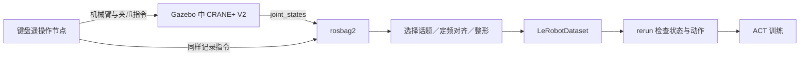

# 第 12 章｜ROS 数据管线：从 rosbag2 到 LeRobot 模仿学习

来源：Mac 本地：`pdfs/13.pdf`、Mac 本地：`homework/12.ipynb`。本章连接 ROS 通信、异步数据记录、训练样本转换、ACT 学习与闭环部署。参考答案为依据题干和课件推导的结果。

## 1. ROS 在学习系统中承担什么

### 1.1 用统一通信接口连接策略、机器人和传感器

> 来源：13.pdf · 第 7、13–14、18–20 页。

ROS（Robot Operating System）提供四层能力：通信基础（plumbing）连接分布式节点；工具（tools）负责启动、监控、可视化与日志，如 `ros2 topic`、`rviz2`、`rqt_graph`；功能库（capabilities）提供导航和操作能力，如 Navigation2、MoveIt2；生态（ecosystem）提供可复用的设备驱动和软件包。CRANE+ 与 RealSense 的 ROS wrapper 把厂商接口封装成节点，便于独立开发、恢复和调试。

| 通信 | 适合的关系 | 本章例子 |
|---|---|---|
| 话题（topic／トピック） | 持续、异步发布与订阅，同一数据可供多个节点读取 | 关节状态、图像、控制指令；rosbag2 主要记录对象 |
| 服务（service／サービス） | 一次请求—响应，适合较快结束的计算或配置操作 | 开关设备、切换模式 |
| 动作（action／アクション） | 较长任务，提供进度反馈及结果 | 导航、复杂运动 |
| 参数（parameter／パラメータ） | 获取、设置和监视节点配置 | PID 增益 |

课件把服务/参数概括为“同步”，这是接口用途的简化；服务客户端也可以异步调用。ROS 2 为多平台、实时与安全能力提供基础，但采用 ROS 2 本身不会自动保证任何应用的实时性或安全性。

不使用 ROS 也能建立学习系统，但直接串行读取设备可能形成阻塞：

```python
# 课件示意，不执行
for timestep in range(max_timestep):
    img = get_rgb_image()        # 等待 30 Hz 相机
    state = get_robot_state()    # 第19页图中为 100 Hz 状态
    action = policy(img, state)
    send_robot_command(action)
```

每次必须等两个读取都完成，再推理和发指令，循环受最慢输入及其他处理时间约束。USB 相机的 OpenCV API、串口状态和 CAN 电机命令还需要各自驱动，错误处理、重试、重连与共享数据互斥都要设计。

**勘误／补充解释**：ROS 通信能减少重复封装，但第 20 页“无需关心锁和并发竞争”不能无条件成立。多线程 executor 中不同回调组可能并行，重入组甚至允许同一回调的多个实例重叠；共享可变数据仍要用合适回调组或锁保护。互斥组限制组内并发，不是把整个程序自动变成线程安全。[ROS 2 官方回调组说明](https://github.com/ros2/ros2_documentation/blob/humble/source/How-To-Guides/Using-callback-groups.rst)

### 1.2 常用 CLI 的输入、用途与结果

> 来源：13.pdf · 第 15–16 页。

> **课件命令速查，仅作学习材料**。前提是安装了对应 ROS 2 软件包，并在当前终端加载 ROS 2 及工作空间环境。大写名称是待替换占位符，不能照抄为真实包/接口名。
>
> | 命令 | 用途、参数与运行位置 |
> |---|---|
> | `ros2 pkg create PACKAGE_NAME --build-type ament_python` | 在工作空间 `src` 创建 Python 包骨架，指定构建类型。 |
> | `rosdep install --from-paths src --ignore-src -r -y` | 在工作空间根目录解析依赖；扫描 `src`，忽略源码内已有包，`-r` 遇到部分错误继续，`-y` 自动确认包管理器问题；不意味着错误已消失。 |
> | `colcon build --symlink-install --packages-select PACKAGE_NAME` | 构建选定包，以符号链接安装适用文件，便于修改 Python 源码。改变构建配置或入口注册仍可能需重建。 |
> | `source ~/WORKSPACE/install/setup.bash` | 让当前 shell 识别工作空间；写入 `.bashrc` 可对新交互 shell 生效。 |
> | `ros2 run PACKAGE_NAME NODE_NAME` | 启动包中已安装/注册的可执行节点。 |
> | `ros2 launch PACKAGE_NAME LAUNCH_FILE` | 按 launch 文件组合启动节点与配置。 |
> | `ros2 node list` / `ros2 pkg list` | 查看运行节点 / 可发现软件包。 |
> | `rqt_graph` | 查看节点与话题连接。 |
> | `ros2 run rqt_image_view rqt_image_view` / `rqt` | 打开图像查看器 / 图形工具容器。 |
> | `ros2 topic list` / `ros2 topic echo TOPIC` | 列出话题 / 持续显示消息内容。 |
> | `ros2 topic type TOPIC` / `ros2 topic hz TOPIC` | 显示消息类型 / 测量订阅端接收到的频率，后者不是硬件采样时刻的直接测量。 |
> | `ros2 service list` / `ros2 service call NAME TYPE REQUEST` | 列出服务 / 用指定类型及请求字段调用服务。 |
> | `ros2 action list` / `ros2 action send_goal NAME TYPE GOAL` | 列出动作接口 / 按目标消息发送任务。 |
> | `ros2 param list` / `ros2 param get NODE PARAM` / `ros2 param set NODE PARAM VALUE` | 列出参数 / 读取 / 设置具体节点参数。 |

## 2. 实验环境：容器、可视化端口与项目依赖

### 2.1 为什么本章需要额外端口

> 来源：13.pdf · 第 2、8–11 页。

本章沿用课程 ROS 2 Humble 桌面镜像。`6080` 将容器的浏览器桌面服务暴露给宿主，`9090` 和 `9876` 用于课程 rerun 可视化服务。浏览器访问 `http://localhost:6080/` 进入桌面；若通过 Dev Container 的 “Attach to Running Container…” 连接，也可使用扩展的端口转发，需确认实际转发状态。

> **课件环境步骤，不在此执行**：Docker Desktop 已安装且可用；原容器内需保留的文件应先确认位置。课程以新名字 `pai_ros2` 建立容器，避免同名冲突。
>
> ```bash
> open -a Docker                   # macOS 启动 Docker Desktop
> docker info                      # 确认 daemon 可连接
> docker pull airobotbook/ros2-desktop-ai-robot-book-humble:latest
> docker ps
> docker stop <CONTAINER_NAME>
> # 课件可选：docker rm <CONTAINER_NAME>
> ```
>
> `pull` 取得镜像，已拉取者可略过；`ps` 确认运行实例，`stop` 停止旧实例，`rm` 删除停止的实例。`Cannot connect to the Docker daemon` 属于引擎连接问题，不能直接推出镜像有问题。
>
> ```bash
> cd ~/Desktop && mkdir -p 261001_pai_ros2_no2 && cd 261001_pai_ros2_no2
> vim run_pai_container.sh          # 也可用 nano
> cat run_pai_container.sh
> chmod +x run_pai_container.sh && ./run_pai_container.sh
> # 后续启动：docker start pai_ros2
> ```
>
> 依次创建工作目录、编辑脚本、检查内容、赋予执行权限并启动；目录名只是课件例子。脚本内容如下（镜像名的排版换行已合并）：
>
> ```bash
> #!/bin/bash
> docker run -d --name pai_ros2 \
>   -p 6080:80 --shm-size=512m \
>   -p 9090:9090 -p 9876:9876 \
>   -v "$(pwd)":/workspace \
>   airobotbook/ros2-desktop-ai-robot-book-humble:latest
> ```
>
> `-d` 后台运行，`--name` 命名实例，`-p 宿主端口:容器端口` 发布服务，`--shm-size=512m` 设置共享内存区域，`-v` 把当前目录绑定到 `/workspace`，让写入该目录的成果保留在宿主。课件在 macOS 架构不匹配时建议加 `--platform linux/amd64`；它选择目标架构，可能涉及模拟，并非 GPU 加速选项。

> 原课件图仅在 Mac 本地：`assets/12/page-11.png`

原图保留 `run_ai_robot_container.sh` 和 `arb-run.bash` 两种脚本：`RESOLUTION=1920x1080` 配置桌面分辨率，`15900:5900` 与 `13389:3389` 分别发布 VNC/RDP 端口，另有 `6080:80`、共享内存及 `--privileged`。后一脚本还保留代理/音频配置，`-e http_proxy=${http_proxy}` 传入代理变量，`MY_IMAGE=...:mine` 指定自建镜像，`$*` 展开脚本参数。启动入口为 `./run_ai_robot_container.sh` 或 `./arb-run.bash`；其新增内容仍只是两项 rerun 端口映射。

**勘误**：源图把注释放在行续接反斜杠之后，如 `-p 9090:9090 \ # 追加`。Bash 的反斜杠必须直接接换行才能续行，照抄这一排版会破坏命令。学习用修正版应把注释放在前一独立行：

```bash
# 新增 rerun 端口；下列两行是 docker run 参数片段
-p 9090:9090 \
-p 9876:9876 \
```

`--privileged` 的广泛权限与相机、网络访问的具体配置关系，见[第 10 章](10_systems_devices.md)。源图含省略号的代理/音频部分不是完整可运行脚本。VNC 桌面中的 Mozc 输入法启动提示与本章训练流程不是同一个问题，课件说明可关闭该提示。

### 2.2 pixi 项目与 rerun 可视化

> 来源：13.pdf · 第 6、31–35 页。

LeRobot 是用于机器人学习的数据与策略框架；Hugging Face Hub 提供数据集、权重与代码。课程以 `pai_training` 组织转换、训练、推理脚本，并把 LeRobot 作为 Git 子模块（submodule）。pixi 管理项目环境及任务；rerun 将图像和状态/动作曲线放到共同时间轴，帮助检验数据。

> **课件环境与公开数据集命令，仅作学习材料**：前提是终端有 Git、网络访问以及课程环境需要的依赖；在项目根目录解析环境。
>
> ```bash
> cd ~ && git clone --recursive https://github.com/matsuolab/pai_training
> cd pai_training
> curl -fsSL https://pixi.sh/install.sh | bash
> echo 'eval "$(pixi completion --shell bash)"' >> ~/.bashrc
> source ~/.bashrc
> pixi install
> pixi run python scripts/visualize_dataset.py \
>   --repo-id lerobot/pusht --episode-index 0 --mode distant
> ```
>
> `--recursive` 同时获取子模块；`curl -fsSL` 下载并由 Bash 执行 pixi 安装脚本，`echo ... >>` 向 `.bashrc` 追加 Bash 补全，`source` 在当前 shell 读取配置，`pixi install` 解析/安装项目环境。`pixi run` 在该环境内运行脚本，`--repo-id` 选择公开数据集，`--episode-index 0` 选择第一条轨迹，`--mode distant` 采用远程浏览器可视化方式。
>
> 预期会弹出 Firefox/显示查看 URL；把 URL 放到宿主浏览器，播放按钮或空格控制播放。课件建议 HTTP 错误或 Too many requests 时等待几秒重试；持续失败还需区分访问权限、网络及服务限流。端口未正确映射会影响查看页面，而不直接说明数据集损坏。

可视化应回答具体问题：图像、状态和动作时间是否对应；是否缺值、跳变或单位异常；episode 开始/结束是否正确。可视化困难时课件允许临时跳过，但这不是“数据无需验证”的结论。

## 3. rosbag2：先记录通信，再构造学习样本

### 3.1 在 turtlesim 中验证“指令与状态都被记录”

> 来源：13.pdf · 第 21–24、26–27 页。

rosbag2 保存话题消息、记录时间及相关元数据，并能重新发布消息。turtlesim 只用来简化实验：人工键盘指令 `/turtle1/cmd_vel` 对应 action，`/turtle1/pose` 对应 observation/state；换成机械臂后，动作话题变成关节轨迹，状态变成 `/joint_states`，记录思路相同。

> **课件练习步骤，仅作学习材料**：在已加载 ROS 环境的三个终端分别启动模拟器、遥操作和记录。Terminator 的 `Ctrl+Shift+E` 为纵向分割，`Ctrl+Shift+O` 为横向分割，`Ctrl+Shift+W` 关闭子终端。
>
> ```bash
> # A：运行模拟器
> ros2 run turtlesim turtlesim_node
> # B：键盘遥操作
> ros2 run turtlesim turtle_teleop_key
> # C：准备保存目录并开始录制
> cd ~
> mkdir -p bag_files && cd bag_files
> ros2 bag record -o turtle_test -a
> ```
>
> `-o turtle_test` 指定输出 bag 目录，`-a` 记录所有可发现话题。聚焦 B 用方向键移动，回到 C 按 `Ctrl+C` 停止记录；目录内的 `metadata.yaml` 保存记录元信息，课件 SQLite 示例中的 `turtle_test_0.db3` 保存消息。
>
> ```bash
> tree turtle_test/
> ros2 bag info turtle_test/
> ros2 bag play turtle_test/
> ```
>
> `tree` 检查文件结构，`info` 查看记录时长、话题、类型和消息数，`play` 重新发布记录的消息。要比较相同轨迹，课件建议先停止并重新启动 A，使海龟回到相同初始状态。回放指令是在控制仍在运行的模拟器，不是播放一段视频；初始状态不同可导致不同终点。

> **课件 rosbag2 命令及压缩选项**：
>
> ```bash
> ros2 bag record TOPIC_NAME
> ros2 bag record -a
> ros2 bag record -o BAG_FILE_NAME -a
> ros2 bag record -a --compression-mode file --compression-format zstd
> ros2 bag play BAG_FILE_NAME
> ros2 bag info BAG_FILE_NAME
> ```
>
> 第一行只记录指定话题；`file` 指按文件压缩，`zstd` 指定压缩格式。要有相应插件和足够持续写入/压缩能力。压缩减少存储，不改变题目中按频率计算的消息数量；是否实际漏消息仍需检查记录结果。

**补充解释**：rosbag2 不会把既有日志自动转换成模型输入张量；它提供可读取的时间序列。第 21 页“任意周期采样”应理解为利用记录的时间戳进行后处理，而不是 `record` 自动把所有传感器硬件采样率改成同一个值。记录、回放和压缩的选项还依所用版本/存储插件而定，本章保留 Humble 课件写法。[rosbag2 Humble 官方说明](https://github.com/ros2/rosbag2/blob/humble/README.md)

### 3.2 异步数据如何对齐：共同时间区间与直前值保持

> 来源：13.pdf · 第 25、43–44、48–49 页。

图像 30 Hz 每约 33.3 ms 一帧，关节状态在第 25 页例子中为 1000 Hz，每约 1 ms 一条。它们的频率不同，也不保证消息同时到达。同步输入策略写成 $\pi(a\mid o)$，其中 $o=[o_{\mathrm{image}},o_{\mathrm{state}}]$，需要明确每个分量对应哪个时刻；支持原生异步输入的策略是另一类架构，课程本次采用定频对齐。

> 原课件图仅在 Mac 本地：`assets/12/page-49.png`

课件 `rosbag2lerobot.py` 的完整转换流程为：

1. 读取 bag 输入目录、输出目录、目标频率 fps，以及 `features`、`robot_type`、`repo_id`、`task_name`，调用 `LeRobotDataset.create` 初始化数据集。
2. 探索目录中的 `.db3`，按 episode 处理；课件约定一 bag 对应一 episode。
3. 抽取 `/joint_states`、`/crane_plus_arm_controller/joint_trajectory`、`/crane_plus_gripper_controller/joint_trajectory` 的消息及时间戳。
4. 取各话题的**共同时间范围**，生成等间隔目标时间；每个目标时刻使用“该时刻以前最近一条”的值，即直前值保持（zero-order hold／直前値保持）。合并机械臂与夹爪指令。
5. 添加帧：`observation.state` 为采样后的 `j_pos_sampled`；本例 `observation.environment_state` 也放入同一值；`action` 为机械臂四轴＋夹爪一轴的五维目标向量；`task` 为任务名。以 `dataset.save_episode()` 保存整条 episode。

**补充解释**：对第 $m$ 个话题的时间戳 $t_{m,j}$ 和值 $x_{m,j}$，这套采样可写为

$$
t_{\mathrm{start}}=\max_m t_{m,0},\qquad
 t_{\mathrm{end}}=\min_m t_{m,\mathrm{last}},\qquad
 t_n=t_{\mathrm{start}}+\frac{n}{f},
$$

$$
j_m(n)=\max\{j:t_{m,j}\le t_n\},\qquad
\tilde x_m(t_n)=x_{m,j_m(n)}.
$$

$f$ 是目标频率，只有 $t_n$ 落在共同范围内才构造样本。例如指令在 0.03 秒为 0.2 rad、0.07 秒为 0.4 rad，目标时刻 0.05 秒选 0.2，0.10 秒选 0.4。它不使用未来信息、不在两值之间插值；低频数据可能连续复用多次，高频数据可能被下采样。

这种“同步”是把记录映射到一个网格，不意味着传感器曾同时采样，也不会消除过时数据。可检查样本年龄 $t_n-t_{m,j_m(n)}$，过大时表明话题间有缺口；时间戳的采集/接收语义及跨设备时钟应先对齐，详见[第 10 章](10_systems_devices.md)。重采样也不能把缺失或错误单位修复成正确数据。

`observation.state` 表示实际关节状态，`action` 表示目标指令，控制器的跟踪滞后会使两条曲线不同；这并不自动意味着转换错误。反过来，把 state 直接当 action 标签，会改变策略到底学习什么。这里复制的 `environment_state` 是课程特定字段设计，不应外推为所有任务都能用机器人关节角代表外部环境状态。

## 4. 从机械臂示范到训练数据

### 4.1 遥操作节点、动作接口与 episode

> 来源：13.pdf · 第 36–42 页。



> **课件包构建与节点启动，不在此执行**：前提是 ROS、Gazebo、CRANE+ 相关包已在课程镜像中可用；每个使用新包的终端应加载工作空间。
>
> ```bash
> mkdir -p ~/pai_ws/src
> cd ~/pai_ws/src && git clone https://github.com/matsuolab/physicalai_teleop.git
> cd ~/pai_ws && rosdep install --from-paths src --ignore-src -r -y
> colcon build --symlink-install --packages-select physicalai_teleop
> source install/setup.bash
> ros2 launch crane_plus_gazebo crane_plus_with_table.launch.py
> # 另一终端：
> ros2 run physicalai_teleop teleop_keyboard
> ```
>
> 先取得源码、安装声明依赖、构建选定包，再让当前 shell 识别安装结果；`launch` 启动带桌子的机械臂仿真，`run` 启动键盘指令节点。预期显示 Gazebo 模型及当前所选关节。

| 键 | 课件功能 |
|---|---|
| Q / E | 切换操作关节；启动选 joint1，课件例 Q 一次到 joint3、E 一次到 joint2 |
| W / S | 增加/减少选中关节角 |
| R / F | 所有关节角一起增减，粗调 |
| O / C | 打开/关闭夹爪 |
| X | 回到全零直立姿态 `[0,0,0,0,0]` |
| ESC | 退出 |

这是关节空间遥操作，单个关节变化未必对应直观的末端移动；末端空间遥操作需要 IK 和合适的可达性约束，见第 2 章。

课程收集 10–20 条鞠躬（pekori）示范，每条一 bag：先 X 回直立、Q 选 joint3，在记录终端开始 bag；聚焦遥操作终端用 W/S 鞠躬，回记录终端 `Ctrl+C` 停止，最后 X 复位。第二条起所选关节可保留，不必再切换。

> **课件记录命令**：Gazebo 和遥操作节点已在运行；以下输出目录按 episode 递增，不能把多个片段误写到同一个已存在目录。
>
> ```bash
> ros2 bag record -a -o ~/dataset/rosbags/pekori/ep0
> # 停止记录并复位后，下一条：
> ros2 bag record -a -o ~/dataset/rosbags/pekori/ep1
> ```
>
> 源图是 `ep0` / `ep1`，不是 PDF 文本提取中出现的 `ep 0` / `ep 1`。窗口焦点决定按键发给哪个节点；`Ctrl+C` 在记录窗口停止记录，在遥操作窗口停止遥操作，不能混为一项操作。

### 4.2 示范质量与转换配置

> 来源：13.pdf · 第 42–45 页。

课件的小样本任务先统一初始状态和轨迹：每次从 X 全零状态开始，避免训练外起点；夹爪尽量明确开/关，避免含糊目标；不要记录大量无意义停顿；统一关节、次数与轨迹，例如 W 十次对应课件示例 0.5 rad。它还说明短 episode 在该课程转换流程中会用最后一帧补齐至最长长度，长度差异可能增加“静止”标签。

**补充解释**：这些是帮助简单任务快速学会的采集规则，不意味着通用机器人数据必须只有一条轨迹。真实策略需要多场景、多初态和适当扰动；同一观测的多个合理动作会给简单回归带来平均化风险，详见第 3 章。ACT 包含潜变量机制，也不能据“轨迹要一意”推断 ACT 在原理上完全不能处理多峰示范。尾帧补齐是课程转换实现的处理方式，并非所有 LeRobot 数据集都必须把 episode 补成等长。

> **课件转换与查看命令**：
>
> ```bash
> cd ~/pai_training
> pixi task list
> pixi run convert
> # convert 对应：pixi run python scripts/rosbag2lerobot.py
> pixi run python scripts/visualize_dataset.py \
>   --root /home/ubuntu/dataset/lerobot_dataset/crane_plus_pekori \
>   --repo-id crane_plus_pekori --episode-index 1 --mode distant
> ```
>
> 前提是 bag 已录制且配置路径正确。`pixi task list` 查看项目定义的 `convert/train/infer/debug-policy`，`convert` 执行转换任务。`--root` 指定本地数据根目录，`--repo-id` 提供数据集身份，`--episode-index 1` 查看第二条轨迹，`--mode distant` 开浏览器查看。检查 action 指令与 state 响应的时间和幅度关系。

| 配置文件 | 决定的内容 |
|---|---|
| `configs/conversion_config.yaml` | 输入 bag 目录、输出目录、目标 fps |
| `configs/crane_features.py` | 数据集名 `repo_id`、任务名 `task_name`、字段与特征定义 |
| `configs/train_config.yaml` | 训练参数、动作时间偏移及执行设置 |
| `pyproject.toml` 的 `[tool.pixi.tasks]` | 任务名到具体脚本/命令的映射 |

RLDS（Open X-Embodiment 等采用）和 HDF5 也是机器人数据格式。课件的 LeRobot 图像按 MP4 视频存储，可降低相对于未压缩图像的体积；压缩收益取决于编码方式和原格式，不能把“HDF5”这个容器名直接等同于“绝不压缩”。本次鞠躬转换主要使用关节状态与动作，没有因为框架支持图像就自动加入视觉输入。

## 5. ACT 学习：预测长度与执行长度是两个参数

### 5.1 Transformer 如何预测动作块

> 来源：13.pdf · 第 46、50 页。

ACT（Action Chunking with Transformers）是基于 Transformer 的模仿学习策略：根据当前观测预测一段未来动作，而不是只拟合下一个动作。课件使用较轻量模型在小型鞠躬数据上学习，重点是完整工程流程；小任务可用少量样本起步，不意味着少量样本足以学习任意复杂任务。

**补充解释**：原始 ACT 可融合多相机特征、当前关节位置及潜在风格变量 $z$，经 Transformer 生成动作序列。训练采用条件变分自编码器（CVAE），帮助表达示范中的行为差异；推理时通常令 $z=0$。课程状态输入任务不要求复现原论文的全部相机输入。[ACT 官方说明](https://huggingface.co/docs/lerobot/act)

将训练目标概括为

$$
\mathcal L=\mathbb E_{z\sim q_\phi(z\mid o,A)}[\|\hat A_\theta(o,z)-A\|_1]
+\beta D_{\mathrm{KL}}\!\left(q_\phi(z\mid o,A)\,\|\,\mathcal N(0,I)\right).
$$

$A$ 是示范动作块，$\hat A$ 为预测块；这里 $o$ 泛指条件信息；原始 ACT 的训练编码器 $q_\phi$ 读取当前关节位置和真值动作块（不读取相机图像）以推断 $z$，动作生成器则可读取图像与关节观测，$\theta$ 参数化动作生成器，$\beta$ 权衡重建与潜变量正则。推理没有未来示范动作，因此不能依赖训练编码器读取真值。原论文还提出 temporal ensembling，对不同预测中重叠时刻的动作加权融合；本课是否使用它应看实际配置，不能把动作分块、每步重推理和时间融合当作同一机制。[ACT 原论文](https://arxiv.org/abs/2304.13705)

### 5.2 本章的 16 步预测、1 步执行

> 原课件图仅在 Mac 本地：`assets/12/page-50.png`

课件要求在 `configs/train_config.yaml` 将 `delta_timestamps.action` 改为 `[0.0,0.1,...,1.5]`，包含 **16 个动作采样时刻**，最后一个距观测 1.5 秒；源配置的初始偏移从 `-0.1` 开始，需要按课程说明修改。这里列的是**时间偏移**，不是十六个关节角，也不是每个动作的维数。

`n_action_steps: 1` 表示每次只执行块的第一步，然后读取新状态重新推理。预测块长度为 16，并不意味着会连续开环执行 1.6 秒，也不意味着推理次数减少到原来的十六分之一。训练利用序列结构，部署采用短执行窗口以快速响应；如果随后改成长块执行，还需考虑队列、时延和初始状态差异，见第 7 章。

### 5.3 训练命令与实验日志

> 来源：13.pdf · 第 46–47 页。

> **课件训练步骤，仅作学习材料**：数据已转换、配置数据路径/特征维数正确，项目依赖已就绪。登录日志服务和离线模式是两种选择。
>
> ```bash
> cd ~/pai_training
> pixi add --pypi "wandb>=0.22"
> pixi run wandb login
> pixi run train
> # 不登录时：
> WANDB_MODE=offline pixi run train
> ```
>
> `pixi add --pypi` 在项目中添加/更新 PyPI 依赖，`wandb login` 配置认证，课件给出的密钥获取入口为 `https://wandb.ai/authorize`。`train` 使用 `configs/train_config.yaml`；在线模式可用日志 URL 查看曲线，离线模式可从终端查看 loss，并保留本地日志。预期输出训练进度及模型检查点。
>
> **课件版本说明**：课程固定的 wandb 0.19.11 对 `wandb_v1_...` 新格式密钥可能报 `API key must be 40 characters long`，因此源页要求升级到至少 0.22，描述的新密钥为 86 字符。这是源课件对应的兼容处理，不是要求所有未来版本都按同一长度检验。

日志服务主要记录和比较实验，不是 ACT 必须的学习信号。“登录与否模型相同”应理解为不改变训练算法和保存机制；随机性、环境及配置仍可能使两次独立运行结果不同。把 loss 曲线和数据版本、配置、检查点一起保存，才能解释性能变化。

## 6. 部署与调试：先验证拟合，再调查闭环失效

### 6.1 把策略放回 ROS 通信链

> 来源：13.pdf · 第 51–52 页。


> **课件部署命令，不在此启动**：Gazebo 已运行，模型目录包含需要的检查点/配置，推理输入及动作接口与训练一致。
>
> ```bash
> pixi run infer --model-path /home/ubuntu/checkpoints/train/crane_plus_pekori_act
> ```
>
> `--model-path` 选择已训练策略目录；节点订阅 `/joint_states`，推理后发布关节指令，预期模拟机械臂鞠躬并在终端显示动作。课程要求先停止遥操作节点：它即使没按键也会以 20 Hz 发指令，与策略争夺控制输入。看到 action 输出只证明节点产生了数值，还要看控制器是否接收并正确执行。

### 6.2 训练数据上的 Ground Truth 对比

> 来源：13.pdf · 第 28–29、53–54 页。

部署失败可能来自策略未学会示范，也可能来自执行状态偏离示范。第一步把已收集数据中的观测输入策略，将预测与专家真值（Ground Truth，GT）比较。

> **课件调试命令，仅作学习材料**：检查点与数据集属于同一特征/动作定义。
>
> ```bash
> pixi run debug-policy \
>   --dataset-root /home/ubuntu/dataset/lerobot_dataset/crane_plus_pekori \
>   --repo-id crane_plus_pekori \
>   --policy-path /home/ubuntu/checkpoints/train/crane_plus_pekori_act \
>   --episode-index 1
> ```
>
> `--dataset-root` 选择本地数据，`--repo-id` 提供身份，`--policy-path` 选择模型，`--episode-index` 选择轨迹。结果应展示/比较同一观察与相应时间偏移上的 GT 和预测动作，而不是拿不同 episode 的曲线硬比较。

| 离线预测与 GT | 部署表现 | 课件建议与必要补充 |
|---|---|---|
| 明显不一致 | 失败 | 先查数据量/品质、标签时间对齐、特征/归一化和训练设置；不急着归咎于泛化。 |
| 较一致 | 失败 | 查初始状态/观测差异及分布覆盖；**补充解释**：也要检查部署单位、关节顺序、指令竞争、控制频率与接口，不能仅凭离线吻合就断定只剩泛化问题。 |
| 较一致 | 成功 | 换 episode、初态和条件继续评价，不能凭一次成功证明普适可靠。 |

离线动作误差不能取代闭环成功率。状态回放测试输入输出映射，部署测试动作如何改变后续状态；应记录成功率、完成时间和失败类型，方法见第 9 章。

课件的错误处理流程可压缩成：读完整错误 → 定位所属层 → 查文档/既有问题 → 提供命令、环境、完整报错和复现条件求助 → 改一处并验证。即便使用 LLM 修复，也要确认错误原因与修改如何影响数据、训练和执行，避免只是让报错暂时消失。

### 6.3 延伸到其他策略

> 来源：13.pdf · 第 57 页。

| 路线 | 课件阅读/练习入口 | 与本章关系 |
|---|---|---|
| ACT 模仿学习 | [training-act.ipynb](https://github.com/huggingface/notebooks/blob/main/lerobot/training-act.ipynb)、[ACT 文档](https://huggingface.co/docs/lerobot/act) | 本章使用自己的示范训练 |
| Diffusion Policy | 课程 `5_ros2_2_lerobot_diffusion.ipynb`、[原项目](https://github.com/real-stanford/diffusion_policy)、[PushT 模型](https://huggingface.co/lerobot/diffusion_pusht) | 以条件去噪生成动作块，课程扩展任务为 PushT |
| SmolVLA | [training-smolvla.ipynb](https://github.com/huggingface/notebooks/blob/main/lerobot/training-smolvla.ipynb)、[文档](https://huggingface.co/docs/lerobot/smolvla) | 视觉语言预训练加动作专家 |
| π0.5 | [LeRobot 文档](https://huggingface.co/docs/lerobot/pi05)、[openpi](https://github.com/Physical-Intelligence/openpi) | 课件只介绍，无对应 Notebook |
| Isaac Lab × G1 强化学习 | [IsaacLab](https://github.com/isaac-sim/IsaacLab)、[unitree_rl_lab](https://github.com/unitreerobotics/unitree_rl_lab)、[NVIDIA 入门课](https://docs.nvidia.com/learning/physical-ai/getting-started-with-isaac-lab/latest/)、[mjlab](https://github.com/mujocolab/mjlab) | 交互/奖励学习；课程说明需要相应 GPU 电脑 |

更换策略不应跳过数据验证，也不能假定同一个 action 向量在不同框架中有相同的单位、时间范围和控制含义。

## 7. 习题与逐项解析

### Q1｜实时查看话题内容

ROS 2 CLI 中，实时显示 `/turtle1/pose` 消息内容的正确命令是哪一项？

1. `ros2 topic list /turtle1/pose`
2. `ros2 topic info /turtle1/pose`
3. `ros2 topic echo /turtle1/pose`
4. `ros2 topic pub /turtle1/pose geometry_msgs/msg/Pose`

**提示**：区分枚举、元信息、订阅读取和发布写入。

**参考答案：3。**

- **1 错误**：`list` 枚举话题名称，不能持续显示消息字段；这个附加话题位置参数也不是通常的 `list` 用法。即使列表出现 `/turtle1/pose`，也不表示已经看到了实际坐标。
- **2 错误**：`info` 查询话题类型及发布/订阅端等元信息，有助于确认连接，但不是逐条输出消息内容。要观察位置随海龟运动变化，需要订阅并显示消息。
- **3 正确**：`echo` 订阅指定话题并把收到的消息字段输出到终端。前提是类型与发布端可发现、通信及 QoS 相容；它观察数据，不负责移动海龟。
- **4 错误**：`pub` 是发送消息，与“读取正在发布的内容”方向相反。题中 `geometry_msgs/msg/Pose` 也不同于 turtlesim 的 `/turtle1/pose` 所用 `turtlesim/msg/Pose`，不能据名称都含 Pose 就认为兼容。

### Q2｜记录全部话题并按文件进行 zstd 压缩

以下哪个 rosbag2 命令最恰当？

1. `ros2 bag record -a --compression-mode file --compression-format zstd`
2. `ros2 bag record -a`
3. `ros2 bag record -o subset`
4. `ros2 bag record --lz4`

**提示**：全部话题、压缩粒度、压缩格式是三个独立条件。

**参考答案：1。**

- **1 正确**：`-a` 选择全部可发现话题，`file` 选择文件级压缩，`zstd` 指定所需格式，三个条件齐全。实际运行还需匹配版本/插件，并检查吞吐是否足以持续记录。
- **2 错误**：它记录全部话题，但没有指定题目所需的文件级 zstd 压缩。记录完整性和压缩方式是不同属性，不能从 `-a` 推出压缩已开启。
- **3 错误**：`-o subset` 只把输出目录命名为 subset，不会把“subset”变成全部话题的选择规则。它也未给出压缩方式，所以不满足题目条件。
- **4 错误**：`--lz4` 不是本课所用 rosbag2 的这组压缩选项，并且 LZ4 与题目要求的 zstd 是不同算法。即使其他工具支持 LZ4，也不能直接移植它的命令行到 rosbag2。

### Q3｜先区分学没学会与部署泛化

将策略部署到模拟器后行为不符合预期。为区分训练失败和泛化不足，课件推荐先做哪一步？

1. 在生产环境添加去除传感器噪声的滤波器。
2. 使用已收集数据集，对比 Ground Truth 与预测动作。
3. 把学习率设成原来的 10 倍，再次训练。
4. 给训练数据增加翻转、旋转等图像预处理。

**提示**：先问策略能不能在已经见过的观测上产生正确动作。

**参考答案：2。**

- **1 错误**：先加滤波是在没有定位原因前修改输入，可能引入新的延迟或分布差异。传感噪声确实可能影响部署，但应在确认拟合和输入/接口情况后有针对性地处理。
- **2 正确**：固定数据观测并与相应 GT 比较，可先判断策略是否连示范映射都未学好。若吻合但部署失败，再查初态、泛化、动作接口及控制时序；离线吻合并不能单独证明全部部署代码正确。
- **3 错误**：学习率放大可能造成不稳定，而且无法检验问题究竟来自标签、模型还是部署。应依据训练曲线和诊断证据调整参数，而不是把十倍学习率当成通用修复。
- **4 错误**：增强需要保持任务与动作标签语义一致，翻转图像却不相应处理动作可能制造错误监督。本课鞠躬例主要使用关节状态，图像增强也未必作用于实际模型输入。

### Q4｜异步话题消息数量

同时以 rosbag2 记录一个 **30 Hz** 相机话题和一个 **100 Hz** 关节状态话题，持续 **3 分钟**。保存的消息总数应是哪一项？

1. 130 条。
2. 5400 条。
3. 18000 条。
4. 23400 条。

**提示**：分别计算各话题频率乘记录秒数，再相加；原始 bag 未因重采样而变成每帧一对。

**参考答案：4。** 在频率恒定、无丢失、只计这两个话题的理想假设下：

$$T=3\times60=180\ \mathrm{s},\qquad
N=(30+100)\times180=23400.$$

- **1 错误**：130 是每秒两话题频率之和，尚未乘以 180 秒。它的量纲是每秒消息数，不是三分钟总条数。
- **2 错误**：$30\times180=5400$ 只计相机消息，漏掉 18000 条关节状态。异步话题独立记录，并不会因为“有图像”才记录一次状态。
- **3 错误**：$100\times180=18000$ 只计关节话题，漏掉相机的 5400 条。数据训练时可能下采样，但题目问的是原始记录消息数。
- **4 正确**：两话题实际产生的消息分别计数后相加得到 23400。真实启动/停止边界、掉帧与 QoS 可能使实测稍有差异，精确结果应由 `ros2 bag info` 检查。

### Q5｜Gazebo → rosbag2 → LeRobot 的实践顺序

课件中的模仿学习流程，哪个顺序正确？

1. Gazebo 收集数据 → Diffusion Policy 训练 → rosbag 转 LeRobot → 部署 → 可视化。
2. rosbag2 记录 → rosbag 转 LeRobot → 数据集可视化 → 策略训练 → 部署到 Gazebo。
3. 数据集可视化 → rosbag 转 LeRobot → 策略训练 → 部署。
4. rosbag2 记录 → 不训练，直接部署到 Gazebo。

**提示**：先生成与验证训练输入，再优化策略，最后测试它的闭环执行。

**参考答案：2。**

- **1 错误**：策略训练需要已经转换好的学习输入，不能把格式转换放在训练之后。本课训练的是 ACT，Diffusion Policy 是扩展选项，不是主流程中这一阶段的实际模型。
- **2 正确**：先保存通信，再选择/对齐话题并整形成 LeRobotDataset，可视化确认输入/标签，然后训练策略并让它控制模拟器。部署后仍需调试、换条件评价，形成反馈循环。
- **3 错误**：题中流程省略了记录步骤，并把本课的 LeRobot 可视化放在产生 LeRobotDataset 之前。原始 bag 当然也能用其他工具查看，但那不是题目所指的完整转换后训练流程。
- **4 错误**：记录产生专家轨迹，不会自动生成可决策的新策略。直接回放 bag 可以复现指令，但回放和训练得到的闭环策略是不同对象。
