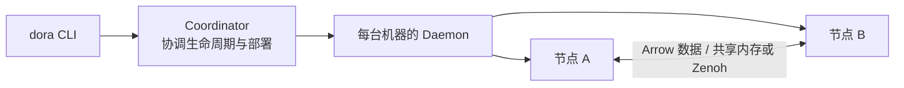
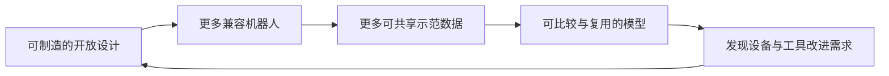

# 第 13 章　机器人开源生态：Dora、许可证、开源硬件与贡献流程

> 本章对应 Mac 本地：`pdfs/14.pdf` 与 Mac 本地：`homework/13.ipynb`。项目版本、规模、性能及产品配置以课件所述的 2026 年 9 月资料为背景；学习重点是软件如何连接、公开哪些材料，以及如何形成可复用的贡献。

## 1. 开源的判断依据是许可的权利

### 1.1 OSS、免费软件与“源码可看”

> 来源：14.pdf · 第 7–10、29 页。

开源软件（Open Source Software，OSS／オープンソースソフトウェア）允许使用者依许可证使用、研究、修改和再分发，且不能仅因个人身份或使用领域不同而剥夺这些权利。**免费是价格，开源是权利与源码条件。**收费销售的程序可以是 OSS，免费下载的闭源程序也可以不是 OSS。

OSI（Open Source Initiative）的 Open Source Definition 有十项要求，可这样理解：

| 要求 | 含义 |
|---|---|
| 自由再分发 | 允许把软件作为发行物的一部分赠送或销售。 |
| 源代码 | 提供适合实际修改的源码及获取方式，不能用故意混淆的形式代替。 |
| 派生作品 | 允许修改、形成派生版本并分发。 |
| 作者源码完整性 | 可以要求区分修改版名称或采用补丁方式，但不能彻底禁止修改后的软件分发。 |
| 不歧视个人或群体 | 不能按使用者所属群体排除权利。 |
| 不歧视用途领域 | 商业、研究等领域不能被许可证一概排除。 |
| 权利随分发传递 | 后续接收者无需另签特殊协议才获得相应权利。 |
| 不局限于某个产品 | 从特定发行版中取出组件后，权利仍适用。 |
| 不限制其他独立软件 | 不能因放在同一发行介质上，就要求全部独立程序都采用相同开源方式。 |
| 技术中立 | 不能把授权绑定于某种特定技术或界面。 |

这些判断来自 [OSI 原始定义](https://opensource.org/osd)。FSF 的“四项自由”则用编号 0–3 表达：为任何目的运行、研究并修改、再分发副本、分发改进版。课件的历史背景可压缩为一句：自由软件强调用户自由，开源协作同时展示了公开审阅与共同维护的工程收益。

因此，“非商业用途限定”“仅研究可用”“可以看源码但不可修改／分发”不符合上述 OSS 定义。后者常称 **source-available（源码可见）**。程序内部使用了 OSS 也不代表整个成品都由同一开源许可证覆盖：课件以 Chromium 与 Chrome／Edge、Code-OSS 与 VS Code、Moby 与 Docker 为例；应识别具体组件和分发物。

课件列举的常见基础组件包括 Linux／Git（GPLv2）、Python（PSF）、PyTorch（BSD-3）、curl（curl license）、OpenSSL（所述版本为 Apache-2.0）、python-pptx（MIT），以及常以 Apache-2.0 发布的 ROS 2、Gazebo、MuJoCo、LeRobot、Transformers。**组件可能另含第三方依赖，许可证应落实到实际文件和版本。**

### 1.2 许可证类型：权利相近，分发义务不同

> 来源：14.pdf · 第 29、38、40 页。

| 类型 | 核心理解与课件简化的修正 | 课件例子 |
|---|---|---|
| MIT | 允许修改、商用、再分发；保留版权声明及许可声明，不能简化为“只留作者名字”。[原文](https://opensource.org/license/mit) | OpenVLA、MEVIUS |
| BSD-3-Clause | 保留版权、条件和免责声明；另含不得擅自用作者／贡献者名义背书的条款。[原文](https://opensource.org/license/bsd-3-clause) | PyTorch |
| Apache-2.0 | 包含明确的专利许可；再分发时保留许可证、适用声明、修改说明，以及原项目附带 NOTICE 中适用的归属信息。不是每个项目都必须凭空创建 NOTICE。[原文](https://www.apache.org/licenses/LICENSE-2.0) | ROS 2、MuJoCo、LeRobot、openpi、Dora、OpenArm 软件 |
| LGPL／MPL-2.0 | 弱 copyleft（弱互惠）：LGPL 主要针对所覆盖的库及组合条件；MPL 以包含 MPL 代码的文件为核心。分发时可能需要提供相应源码，并非只要使用就必须公开整个应用。[LGPL 原文](https://opensource.org/license/lgpl-3-0)、[MPL 官方说明](https://www.mozilla.org/en-US/MPL/2.0/FAQ/) | Qt、Firefox |
| GPL-2.0／GPL-3.0 | 强 copyleft：向他人分发所覆盖作品／派生程序时，需满足相应许可及源码提供要求。私人修改不等于必须向全世界发布；仅与独立程序放在同一介质也不自动把它们变成 GPL。[GPL-3.0 原文](https://opensource.org/license/gpl-3.0) | Linux、Git |
| CERN-OHL v2 | 硬件设计许可证，P 为 Permissive，W 为 Weakly Reciprocal，S 为 Strongly Reciprocal。P/W/S 可帮助理解共享义务强弱，但不是 Apache/LGPL/GPL 的法律等号。[S 原文](https://opensource.org/license/cern-ohl-s-2.0)、[W 原文](https://opensource.org/license/cern-ohl-w-2.0) | OpenArm 硬件 S、YUBI 硬件 W |
| CC BY／CC BY-SA 4.0 | 归属及修改说明等条件；SA 对分享的改编材料增加相同条件共享要求。适用于课件列举的设计／数据材料，不应据此替代软件的具体许可判断。[CC BY-SA 官方说明](https://creativecommons.org/licenses/by-sa/4.0/) | 部分 3D 打印设计、数据集 |
| CC BY-NC／研究限定 | 因限制商业或用途，不符合本章 OSI／OSHWA 的开放定义；“允许下载”仍可能伴随较窄使用条件。 | 某些数据或模型发布 |

上述表格用于读懂项目条件，不能用一个类别名替代具体许可文本。发布自己的项目时应提供明确的 `LICENSE`，并保留引入材料的适用声明。把 GPL 代码复制到 MIT 项目后仅改许可证标题，并不能消除原条件。

### 1.3 Open Weight 与 Open Source AI

> 来源：14.pdf · 第 30–32 页。

开放权重（Open Weight／重み公開）使人有机会在本地加载已学参数，但可能缺少复现训练、修改训练流程所需的材料。按 **OSI Open Source AI Definition 1.0**，应同时考察：

| 材料 | 需要解决的问题 |
|---|---|
| Data Information（数据信息） | 来源、覆盖范围、特性、选择、标注、处理与过滤，以及公开／第三方可取得数据的清单和获取方式；详细到熟练者可建立实质等价系统。 |
| Code（代码） | 训练和运行所用完整源码，包括适用的数据处理、训练配置、验证测试、架构与推理。 |
| Parameters（参数） | 权重和相关配置；适用时涉及重要中间 checkpoint、优化器状态等。 |
| 公开与使用条件 | 材料与系统需要让使用、研究、修改、分享的自由能够实际成立。 |

**勘误：Data Information 不等于一律要求公开全部原始训练数据。**定义明确考虑无法直接分享的数据，但要求描述相关信息；反过来，也不能只写“用了大量网络数据”就声称满足要求。权重挂上宽松许可证不能补足缺失的训练代码和数据信息。[OSI OSAID 1.0 原文](https://opensource.org/ai/open-source-ai-definition)

课件用以下发布模式作对照，不能把一张表当成对整个模型家族所有版本的统一认证：

| 课件中的例子 | 它想说明的差别 |
|---|---|
| OLMo 2、Pythia | 较完整地提供权重、代码和数据相关材料，课件作为 Open Source AI 一侧的例子。 |
| Llama 3/4、Gemma | 可得权重与推理材料，但存在各自条款／使用限制；模型下载与 OSI 意义的开放不是一回事。 |
| Qwen／DeepSeek、gpt-oss | 课件列举部分采用 Apache-2.0／MIT 的权重发布，但训练材料仍需另查；宽松权重许可不自动使完整系统满足 OSAID。 |

课件提及的 Llama 限制有具体例子：Llama 3 许可纳入 AUP，且发布时前一个月相关产品／服务月活超过 7 亿的特定主体需要另获授权。这里保留的是该版本条款，不能笼统理解成“任何下载者都需要额外批准”。[Llama 3 官方许可](https://github.com/meta-llama/llama3/blob/main/LICENSE)

VLA 也应逐层阅读开放范围。下面保留课件的技术对比；“未公开”均指所述版本与材料范围：

| 模型 | 课件记载的权重／代码／数据情况 | 可据此做什么、还缺什么 |
|---|---|---|
| SmolVLA，450M | Apache-2.0；训练与推理代码；481 个社区机器人数据集、约 22.9k episodes | 较容易研究数据、训练和部署路径；CPU／单 GPU 的可行配置仍需匹配任务。 |
| OpenVLA，7B | MIT；训练／推理与 OFT 微调方法；使用 Open X-Embodiment | 可研究及微调公开实现。OXE 是多数据集集合；课件列为 CC BY 4.0，实际复用还应检查所选组成数据的发布信息。 |
| π0／π0.5，openpi | Apache-2.0 的相关代码与权重，提供推理和微调；大规模自采预训练数据未完整公开 | 可作为本地机器人基线，但不能由此完整重建论文全部训练过程。 |
| GR00T N1→N1.7 | 权重采用 NVIDIA Open Model License，代码 Apache-2.0；合成数据与部分真实数据开放 | 权重、代码和数据是不同许可对象；商业可用也不等于所有训练材料已开放。 |
| X-VLA，约 0.9B | 权重和代码公开；涉及 DROID、RoboMIND、AgiBot，部分数据不可得 | 集成进 LeRobot 不意味着其全部训练来源都能完整取得。 |
| π*0.6／π0.7 | 课件所述版本主要以论文／博客展示，权重与训练数据未公开 | 公开描述与可下载重现是不同层次。 |
| Gemini Robotics、Helix、Optimus | 课件中为受限 API／SDK、有限访问或闭源发布 | 能通过产品调用不代表获得权重、训练代码或修改权。 |

OXE 官方仓库把软件标为 Apache-2.0、其他发布材料标为 CC BY 4.0，同时另列组成数据的来源与元信息；具体复用某个子集时应一并核对原始发布资料。[Open X-Embodiment 官方仓库](https://github.com/google-deepmind/open_x_embodiment)

以 π0.5 为例，课件列出的公开 checkpoint 是 `pi05_base`、`pi05_droid`、`pi05_libero`，并有 PyTorch／JAX 推理与微调、LeRobot 移植。课件同时指出预训练数据、高层 subtask 预测的两阶段推理，以及 π0.6 的 RL 部分没有随这些公开实现一并提供。**“能 fine-tune”与“能复现原论文全部系统”应分别判断。**

## 2. 开源机器人软件栈与 Dora 数据流

### 2.1 四层软件各解决什么问题

> 来源：14.pdf · 第 11–16、22–27 页。

| 层 | 代表 | 工程角色 |
|---|---|---|
| OS 与包管理 | Debian、Ubuntu、apt | 内核、依赖、二进制包、升级与安全维护，是运行环境的基础。 |
| 机器人中间件（middleware／ミドルウェア） | ROS 2、dora-rs | 连接节点、组织通信和数据流。 |
| 物理仿真 | MuJoCo、Gazebo 等 | 在可控制条件下学习、评价、生成数据、试验控制逻辑。 |
| 学习库 | LeRobot | 统一数据格式、机器人接口、策略训练、部署和评价入口。 |

Debian 是 Ubuntu 的重要上游基础，ROS 2 也以面向相应 Ubuntu 版本的 `.deb` 形式分发。课件用约七万包、多 CPU 架构说明包管理的规模；真正重要的是有人持续维护依赖、构建、漏洞和兼容性。Debian 按宪法和公开协作机制运作：开发者通过投票选 DPL，技术委员会处理相关技术争议，GR 处理一般决议；Release、Security、ftp-master、语言打包团队和包维护者分工。GPG 签名与信任网络用于建立身份／上传信任，DM 的授权上传与 DD 的权限／投票地位体现逐步建立的信任。

运营也需要构建服务器、镜像和硬件。Debian 借助 SPI 等受信任非营利组织及赞助支持，LeRobot／MuJoCo 则有企业主导，Dora 是较小核心团队加社区。维护者人数、审阅能力和资金来源影响项目能否长期支持接口，而不仅是 GitHub star 数。

### 2.2 Dora 的架构与 ROS 2 的区别

> 来源：14.pdf · 第 15–17、21 页。

DORA 是 **Dataflow-Oriented Robotic Architecture（面向数据流的机器人架构）**。应用被写成有向图：节点处理数据，边把一个节点的输出接到另一个节点的输入。核心以 Rust 实现，节点可以是 Python、Rust、C、C++ 脚本或二进制；图写在 `dataflow.yml` 中。



课件架构中 Coordinator 使用 WebSocket `:6013`，Daemon 负责机器侧管理；这条控制路径与节点间数据路径要分开理解。Apache Arrow 提供跨语言内存表示，同机共享内存减少大消息复制，跨机器则仍需网络传输。课件以大于约 4 KB 的消息说明零复制路径，并引用项目同类 Python 负载下比 ROS 2 `rclpy` 延迟低约 10–17 倍的基准；这是特定基准，不能推广为所有机器人应用都同倍加速。[Dora 官方项目说明](https://github.com/dora-rs/dora)

| 维度 | ROS 2 | 课件所述 Dora |
|---|---|---|
| 通信 | 常见 DDS，如 Fast DDS／Cyclone DDS；也可使用 Zenoh 相关 RMW | Zenoh 与共享内存，Arrow 数据表示 |
| 消息描述 | `.msg`、`.srv`、`.action`，由接口定义生成语言绑定 | Arrow 数组，可选类型 URN，例如 `std/media/v1/Image` |
| 组织应用 | launch、参数、工作空间 | `dataflow.yml` 声明节点与入／出边 |
| 构建／环境 | `colcon`、`ament`、source 工作空间 | `dora build` 可组织声明的构建／依赖步骤，课件提到 uv |
| 互操作 | 庞大设备驱动、工具与产业生态 | ROS 2 bridge 连接 topic／service／action；hub 提供可组合节点 |

Dora hub 的课件例子包括相机、YOLO、SAM2、Qwen-VL、Whisper、SO-101、Piper、Reachy、MuJoCo。选型应结合需要的驱动、诊断工具、消息语义和团队维护能力，而不只是测一个通信数字。

**补充解释：**“零复制”要求底层内存布局、数据类型、生命周期和接收接口支持；任意 Arrow→NumPy／Polars／Torch 转换都零复制的说法过强。类型转换、跨设备搬运或不兼容布局仍可能复制，尤其不能把 CPU 共享内存直接当作已在 GPU 显存。[Apache Arrow 数组转换文档](https://arrow.apache.org/docs/python/generated/pyarrow.Array.html#pyarrow.Array.to_numpy)

### 2.3 逐句读懂 `dataflow.yml` 与节点代码

> 来源：14.pdf · 第 17、20–21 页；homework/13.ipynb · Q2。

> **课件示例：仅阅读与解释，不启动数据流。**课件标注以 Dora 1.0.1 验证。要运行完整例子，还需要安装匹配版本、`pyarrow`，并提供 `doubler.py` 与 `printer.py`；幻灯片仅展示前者。

```yaml
# dataflow.yml
nodes:
  - id: doubler
    path: doubler.py
    inputs:
      tick: dora/timer/millis/500
    outputs: [doubled]

  - id: printer
    path: printer.py
    inputs:
      message: doubler/doubled
```

`id` 是图中的节点身份，`path` 指定实现文件。`tick` 是 **doubler 本地输入名**，映射到系统内置 500 ms 定时器，约每秒触发两次；`outputs: [doubled]` 声明它产生的输出端口。`message: doubler/doubled` 则将 **doubler 的 doubled 输出**接到 **printer 的 message 输入**，左侧是接收者本地名字，右侧是“来源节点／来源输出”。YAML 描述连接，不会自行进行乘二运算。

```python
# doubler.py
import pyarrow as pa
from dora import Node

node = Node()
count = 0
for event in node:              # 也可用 node.next()
    if event["type"] == "INPUT":
        count += 1
        node.send_output("doubled", pa.array([count * 2]))
    elif event["type"] == "STOP":
        break
# event type: INPUT / INPUT_CLOSED / STOP / ERROR
```

`Node()` 连接节点运行时；迭代器接收事件。每个 `INPUT` 使计数器加一，再把 `[2]、[4]、[6]…` 包装成 Arrow 数组从 `doubled` 输出。**这里乘二的是输入事件的累计次数，不是把 timer 传来的数值乘二。**收到 `STOP` 后结束循环。课件还列出 `INPUT_CLOSED`（输入关闭）和 `ERROR`（错误），这段最小示例没有为二者编写处理逻辑；若添加多个输入，还需区分事件来源，不能再假定每个 INPUT 都是 timer。


> **课件运行命令**
>
> ```bash
> dora run dataflow.yml
> ```
>
> 参数是图配置文件，预期按其节点与边启动本地数据流。课件没有给出 `printer.py` 的完整实现，因此不能只复制这页两段代码就声称已经具备完整项目。`dora build` 是准备图中构建步骤的入口，不等于替代所有语言的依赖管理。

> 原课件图仅在 Mac 本地：`assets/13/page-21.png`

图展示四种通信语义：**Topic** 由 publisher 向一个或多个 subscriber 推送；**Service** 是 client 发请求、server 返回响应；**Action** 是 client 发 goal，server 在执行中回 feedback，最后回 result；**Streaming** 是 source 连续向 consumer 传输数据。图中 service 中央虽只清楚标出 response，双向交互仍应理解为请求和响应；不能把 action 的持续反馈与一次性 service 混为一谈。

### 2.4 OpenArm 把硬件能力拆成可组合节点

> 来源：14.pdf · 第 18–19 页。

OpenArm 的课件配置是每臂 7 自由度、额定载荷约 4.1 kg（峰值 6.0 kg）、每臂八个 Damiao QDD 电机、1 kHz CAN-FD 与 MISUMI 框架。QDD 是准直驱驱动；手臂关节自由度与含夹爪的驱动器数量并不要求相等。OpenArm Cell 提供框架／作业单元，KER 对应手部交互硬件。LeRobot 的 `--robot.type=openarm_follower` 选择 follower 机器人类型，不能单靠此参数完成硬件连接与标定。

| 仓库／节点组 | 作用 |
|---|---|
| `openarm_hardware`、`openarm_description` | CAD、STEP/STL；URDF／xacro 描述几何、关节等机器人模型。 |
| `openarm_can`、`openarm_driver`、`openarm_control` | C++ CAN-FD 库（课件提到 PPA 分发）、设备驱动与控制。 |
| `openarm_ker`、`openarm_ker_firmware` | KER 硬件侧集成和固件。 |
| `openarm_mujoco`、`openarm_dataset` | MuJoCo 仿真以及异步数据格式。课件包入口 `pip install openarm-mujoco` 用于安装仿真相关 Python 包，需相容环境，不是实机启动命令。 |
| `dora-openarm`、`dora-openarm-ker`、`-vr`、`-webxr` | 机器人接口与 KER／VR／WebXR 交互来源。 |
| `dora-openarm-data-collection`、`-ui` | 数据采集流程和界面。 |
| `dora-openarm-dataset-recorder`、`-replayer` | 记录／回放数据。 |
| `dora-opencv-image-splitter`、`dora-openarm-kinematics`、`-cell-lifter`、`-mujoco` | 图像拆分、运动学、升降机构与仿真连接。 |
| `dora-openarm-evaluation`、`-ui` | 策略评价流程和界面。 |
| `dora-openarm-observer`、`-actions-executor` | 观测汇集与动作执行。 |
| `dora-openarm-local-policy-server`、`-docker-policy-server` | 本地或容器内策略服务。 |
| `dora-openarm-inference-controller`、`-quitter`、`-classifier` | 推理流程管理、退出及分类相关模块。 |
| `openeval-runner`、`openeval-web` | 评价运行与 Web 侧工具。 |

拆成小仓库的意义是明确接口和维护范围：修改一个相机节点不应要求重写整套机器人，首次贡献也可以局限于某个接口或修复。名字带前缀省略写法的项目，完整名称按本行已给前缀组合。

## 3. LeRobot、仿真与可比较的实验

### 3.1 统一数据和策略入口为什么有价值

> 来源：14.pdf · 第 22–25 页。

LeRobot 将**采集 → 训练 → 评价**连成一条路径。课件列出的 LeRobotDataset v3.0 使用 Parquet 加视频，支持 Hub 上的数据获取／流式处理；库还统一机器人、遥操作、相机驱动，以及 `lerobot-record`、`lerobot-train`、`lerobot-eval` CLI 和异步推理服务。常见设备包括 SO-101、Koch、OpenArm、Reachy 2、G1。

政策与模块通过 PR 汇入共同接口：

| 实现／扩展 | 本章中的意义 |
|---|---|
| ACT、Diffusion、TD-MPC | 初始策略实现，分别提供动作块模仿、扩散动作生成、模型预测控制相关方法。 |
| VQ-BeT | 论文作者贡献离散潜变量行为生成实现；后来用户可从共同训练接口使用。 |
| π0／π0-FAST／π0.5 | 课件举例 JAX→PyTorch 移植，让模型进入一致的训练／部署环境。 |
| HIL-SERL | 人在环的实机强化学习。 |
| RTC（Real-Time Chunking） | 推理时的动作块衔接方法；集成这一部分不表示完整论文训练方案也已实现。 |
| SmolVLA、GR00T N1.7、X-VLA、EO-1、MolmoAct2、WALL-OSS | 新策略可在共同框架中接入和评价。 |
| Policy plugin | 让外部策略扩展通过约定接口接入，降低维护独立 fork 的需求。 |
| Robometer、TopReward、新 benchmark | 开放贡献对象还包括奖励模型和评价，而非只有策略网络。 |

接口一致有助于复现，但公平比较仍要固定数据版本、任务、随机种子、控制参数及评价预算，不能只看到大家都执行 `lerobot-train` 就认为条件相同。

### 3.2 LIBERO 与 MuJoCo

> 来源：14.pdf · 第 25–27 页。

LIBERO 基于 robosuite／MuJoCo，课件概括为五个 suite、130 个任务。**口径说明：**原论文按 Spatial、Object、Goal、LIBERO-100 四组计数，共 130 个任务；LeRobot 接口将最后一组拆为 LIBERO-90 与 LIBERO-10（Long），因此显示五组，任务总数不变。所展示的 LeRobot 常用评价覆盖 Spatial、Object、Goal、Long 四个 suite，每组十任务、每任务十个 episode：

$$N_{\mathrm{eval}}=4\times10\times10=400.$$

Long 在命令里写成 `libero_10`。这里 400 是所述评价配置，不是 LIBERO 的不可修改定义。课件列出的 `lerobot/libero` 包含 1,693 个示范 episode；`lerobot/pi05_libero_finetuned` 的平均成功率 97.5% 与 OpenPI 版本 96.85% 是对应配置的报告结果，不能忽略种子和协议差别直接宣称算法绝对更强。

> **课件安装与评价片段：未执行**
>
> ```bash
> pip install -e ".[libero]"
> lerobot-eval --env.type=libero --env.task=libero_spatial,libero_object,libero_goal,libero_10
> ```
>
> 第一行要求当前目录为 LeRobot 源码项目，`-e` 为可编辑安装，`[libero]` 选择额外依赖。第二行指定环境类型与 suite 列表，课件省略了待评价策略等参数。
>
> **经官方文档核实的完整结构示例**（`your-policy-id` 是待替换值）：
>
> ```bash
> lerobot-eval \
>   --policy.path="your-policy-id" \
>   --env.type=libero \
>   --env.task=libero_spatial,libero_object,libero_goal,libero_10 \
>   --eval.batch_size=1 \
>   --eval.n_episodes=10 \
>   --env.max_parallel_tasks=1
> ```
>
> `--policy.path` 选择策略；`batch_size` 指同时运行的评价环境数；`n_episodes` 是每任务 episode 数；`max_parallel_tasks` 限制并行任务数。预期得到任务成功率等评价结果，前提是策略、依赖和环境兼容。[LeRobot 官方 LIBERO 文档](https://huggingface.co/docs/lerobot/libero)

MuJoCo 的开源物理引擎支撑此类基准；MJX 使用 JAX 组织加速计算，MuJoCo Warp 面向 GPU，mjlab 将相关仿真能力与类似 Isaac Lab 的工作流结合。课件还提到 Isaac Lab、Genesis、Gazebo，以及 Meta-World、RoboTwin 2.0、RoboCasa365、LIBERO-plus 等评价入口。**代码许可是否开放、是否接受外部 PR 是两个问题**，不能仅由项目暂不接收 PR 判断它一定不符合 OSS 定义。

### 3.3 仿真用途与 sim2real

> 来源：14.pdf · 第 26–27 页。

仿真能并行运行大量 RL 环境；在固定条件下重复评价；用合成图像或仿真遥操作补充数据；在实机前检查控制和系统逻辑。课件对应例子包括 legged_gym→MEVIUS、LIBERO／SimplerEnv／ManiSkill、GR00T 合成数据／RoboCasa、ROS 2+Gazebo 或 MuJoCo+Dora。

sim2real 差距（シミュレーションと実機のずれ）来自摩擦与接触模型、执行器延迟和背隙、传感器噪声／延迟、光照与材质。三种方法侧重不同：

- **域随机化（domain randomization／ドメインランダマイゼーション）**：训练时随机改变质量、摩擦、延迟等，使策略不只适应一个理想参数点。
- **系统辨识（system identification／システム同定）**：测量实机并拟合仿真参数，使其更贴近具体机器人。
- **Real2Sim**：扫描／重建真实场景，为仿真提供相近环境。

**补充解释：**随机化培养“面对一类误差仍能工作”的鲁棒性，辨识减少已知机器人上的误差，两者可以一起使用。还需检验仿真评价能否预测实机相对表现；SimplerEnv 的相关性研究就是这种验证，仿真高分本身不构成实机成功保证。

## 4. 开源硬件：从设计文件到可制造机器人

### 4.1 OSHW 公开的必须是可修改的设计

> 来源：14.pdf · 第 40 页。

开源硬件（Open Source Hardware，OSHW／オープンソースハードウェア）让人依许可研究、修改、分发设计，并制造、使用和销售相应硬件。要公开适合修改的设计文件，例如原生 CAD、回路图、BOM（Bill of Materials，物料清单）；成品照片或只有难以修改的导出物不等于充分设计源文件。公开范围也应清楚说明。

必要软件应有足够开放的实现或接口说明，使人能够完成硬件基本功能；不能只开放外壳却把必要控制接口完全藏住。按 OSHWA 定义，许可不能歧视个人或用途，也不能禁止商业制造。设计、控制软件和数据可以采用不同许可证，应分别检查。[OSHWA 原始定义](https://oshwa.org/definition/)

OSHWA 认证给符合要求的项目标识 UID（课件举例 `us001095`）；是否认证与是否实际提供充分设计材料应分别看。硬件的开源不会消除购买零件、加工、组装和校准成本，但相同设计可使不同实验室拥有更接近的物理条件，从而方便共享数据、仿真与策略。

### 4.2 不同硬件路线的技术特点

> 来源：14.pdf · 第 18、40–43 页。

以下规格与成本仅保留课件的项目例子，用来理解设计取舍，不是当前购买报价。

| 项目 | 结构与技术路线 | 公开材料／复用价值 |
|---|---|---|
| OpenArm | 每臂 7 DoF 双臂，额定约 4.1 kg；QDD、电机 CAN-FD、金属框架；课件双臂一套约 US$6,500 | 硬件 CERN-OHL-S、软件 Apache-2.0；Cell、KER 与学习／评价工具衔接。 |
| SO-100／SO-101 | 5 个手臂自由度加夹爪，六个 Feetech STS3215；3D 打印件；课件 follower 约 US$122、两臂约 US$230 | CAD／代码按课件为 Apache-2.0；低成本同构设备便于社区采集示范。 |
| LeKiwi／XLeRobot | 移动底盘加 SO-101，或推车加双 SO-101 等组合 | 展示共享机械模块如何组合成移动操作系统。 |
| MEVIUS | 四足、十种金属件、十二个 CubeMars AK70-10；板金焊接／切削，零件可经电商采购；课件概算约 180 万日元 | MIT 项目例子；硬件、软件与 legged_gym RL 学习环境共同开放，学习后移到实机。 |
| MEVITA | 两足，十八种金属件，其中四种板金焊接件；LiDAR、IMU | 沿用可在线制造采购的路线，扩展为两足。 |
| MEVIUS2 | 更大型四足，LiDAR 加 HDR 相机 | 一并公开硬件、软件、训练环境。 |
| Open Duck Mini／Microduck | 3D 打印小型两足，MuJoCo RL 步行，附 ONNX 策略；课件 BOM 不到 US$400 | Apache-2.0 项目例子，提供从设计、仿真到部署策略的链路；Microduck 展示产品化路径。 |
| YUBI | 手指驱动的遥操作夹爪／手套，Dynamixel 加 3D 打印，可装于 UR／Franka | 硬件 CERN-OHL-W v2；STEP/STL、BOM、组装说明；课件数据规模为 8,434 h、120 万 episodes、119 任务，数据标注 CC BY-SA 4.0。 |

> 原课件图仅在 Mac 本地：`assets/13/page-43.png`

图中 YUBI 同时标出手指驱动（Finger-driven Actuation）与基于 VR 的跟踪（VR-based Tracking）：前者表达夹持意图，后者提供位姿跟踪通路。机械设计、传感、控制、记录和学习材料结合起来，才便于别人复现完整工作流。

课件还列举 ALOHA／Mobile ALOHA、使用 3D 打印减速机构的 Berkeley Humanoid Lite、HopeJr、Reachy Mini、K-Bo、AhaRobot。它们说明可开放的对象从机械臂到移动平台、腿足、遥操作装置都有。SO-100 社区的机器人示范为 SmolVLA 提供训练数据，但“只用这些机器人数据”不能理解成底层预训练视觉语言模型从未使用其他数据。



### 4.3 制造服务各接收什么、产出什么

> 来源：14.pdf · 第 44 页。

| 工序 | 课件服务／器件例子 | 设计资料与适用点 |
|---|---|---|
| 家用 3D 打印 | Bambu Lab A1 mini／A1 | 打印 SO-101、Open Duck Mini 一类塑料件。课件建议 PLA+ 的语境是这些零件，不应推广为任意承力、温度要求都满足。 |
| 外包 3D 打印 | JLC3DP、DMM.make | 从设计文件制造树脂或尼龙等零件，MJF 是可选工艺之一；须匹配强度、尺寸与材料。 |
| PCB／PCBA | JLCPCB、EasyEDA | PCB 制造电路板，PCBA 进一步完成元器件装配，适用于电机驱动／传感器板；不能把制板价格等同于完整装配成本。 |
| 金属加工 | MISUMI meviy | 上传 3D CAD 后报价，板金／切削制造框架或支架，例如 MEVIUS／OpenArm。 |
| 电子模块 | 秋月电子通商、Switch Science | 可先使用现成传感器或控制模块验证系统，再考虑定制板。 |
| 电机与执行器 | Feetech、Dynamixel、Damiao、CubeMars | 扭矩、速度、减速、通信和反馈能力影响选择，也决定成本。 |

补充解释：BOM 指明“买哪些零件”，CAD／回路图指明“如何制造或连接”，组装与校准说明指明“如何把零件变成可工作的系统”；三类材料彼此不能替代。

## 5. 把使用经验变成可接受的开源贡献

### 5.1 Issue 与 PR 的信息结构

> 来源：14.pdf · 第 24、34–38、46–48 页。

项目持续运转需要审阅、验证和维护。企业可能通过共同维护基础设施降低成本，通过开放接口发展生态、增强可审计性，并保留部分产品或训练数据；个人贡献则把一次局部修复变成全体用户可用的改进。代码公开、治理透明、接受贡献和完整训练复现是不同维度。

| 贡献类型 | 示例 | 审阅关注点 |
|---|---|---|
| Issue | 某命令报错、设备接口失效 | 环境和最小复现是否让别人重现。 |
| 文档／typo／翻译 | 修正 README 或命令 | 事实是否准确，读者是否更容易照做。 |
| 依赖／构建／CI | 一个依赖名称、版本或构建脚本修复 | 是否破坏其他支持环境。 |
| 小 bug | 边界值、None 检查、异常处理 | 修复是否覆盖问题并保留原有行为。 |
| 节点／包 | dora-hub 传感器节点、ROS 包 | 接口、许可、文档和后续维护。 |
| RFC／REP／设计讨论 | 影响项目整体结构的提案 | 动机、取舍和社区方向。 |

Issue 应先搜索已有记录并读模板，然后提供：具体标题；OS、Python、包版本；最短复现命令和日志；期望行为与实际行为。课件标题例子是“`dora build` 在 macOS 的 uv 0.8 环境失败”，比“不能运行”更便于定位。`dora --version` 用于取得工具版本，不会运行机器人。


PR 描述应说明“为什么改、改后行为、怎样验证”，不要混入无关整形或功能。提交后还需要回应 review；存在分歧时给出理由和证据，不必把所有意见机械接受，但也不能把提交本身当作完成。

### 5.2 课件中的贡献命令与审阅标准

> 来源：14.pdf · 第 24、36–38、47–48 页。

> **课件贡献流程命令：仅作学习资料，不在此安装、提交或发 PR**
>
> ```bash
> pre-commit install
> pytest -sv ./tests
> git commit -s
> ```
>
> `pre-commit install` 在已有开发仓库里安装提交前钩子，依赖项目的 pre-commit 配置，课件举 ruff 等检查；它不是运行所有测试。`pytest -sv ./tests` 执行测试目录，`-s` 不捕获标准输出、`-v` 提供详细测试信息，前提是开发依赖和测试资源已备好。`git commit -s` 添加 Signed-off-by 行，用于项目要求的 DCO 声明；**它不是 GPG 密码学签名**，也不等同于 CLA。
>
> 课件还要求将分支 rebase 到 `upstream/main` 再按模板提出 PR。其用途是使修改基于更新的上游提交；实际远程和分支应来自目标项目，而不是生搬一个命令到任意仓库。

LeRobot 的 CONTRIBUTING 还要求贡献者在自己的 PR 获关注前，先审阅至少一个他人的 open PR；AI 政策应按项目阅读，显著使用 AI 时依规则披露，并由提交者理解和验证修改。[LeRobot 官方贡献指南](https://github.com/huggingface/lerobot/blob/main/CONTRIBUTING.md)

课件的 VQ-BeT PR 案例说明实质审阅会关注：删除不能通过配置启用的无用分支；使用配置对象而不是不断增加 kwargs；用明确完整的变量名；合并重复 MLP 类；写清 docstring 与张量维度。目标不仅是“某个例子能跑”，还包括别人能读懂、测试和继续修改。

小贡献同样有用：`python-dev`→`python3-dev` 修正构建依赖语义，`episode`→`episodes` 修正文案，异常／tag 处理修复边界行为。需要的验证深度随行为影响变化，不应为了显得工作量大而把无关功能塞进一个 PR。

DCO、CLA、Code of Conduct、AI_POLICY 和 CONTRIBUTING 各解决不同问题：贡献权利声明、授权协议、行为规范、工具使用要求和工程流程。使用 AI 降低了生成代码的成本，却不自动降低维护者的审阅成本；重复、未理解或未验证的大量修改反而消耗项目资源。

课件给出的练习仓库是 [pai-2026-advance-oss-lecture](https://github.com/matsuolab/pai-2026-advance-oss-lecture)，目标是阅读 README／贡献说明并体验 PR 流程；本讲义只解释该流程，不代替读者向项目发送内容。发布自己的研究成果时，代码配 `LICENSE` 与运行说明，硬件配 CAD／BOM／组装说明，数据说明格式与来源，必要时附论文、项目页和演示，才能让别人从“看到成果”走向“复现并改进”。

## 6. 习题与逐项解析

以下参考答案由课件与定义推导，资料未提供官方答案键。

### Q1　什么是 OSS

**按照课件介绍的 OSI 定义，哪一项最恰当地解释开源软件（OSS）？**

- **A.** 只要能查看源代码，即使禁止修改和再分发，也属于 OSS。
- **B.** 能免费下载的软件，即使没有公开源码，也属于 OSS。
- **C.** 依许可证条件，任何人可以为任何目的使用，并可修改、再分发源代码。
- **D.** 只允许研究用途，是 OSS 的必备条件。
- **E.** 企业主导开发的软件，无论公开条件如何都不能属于 OSS。

**提示：**分别判断源码、修改／分发权、用途限制，不看价格或开发者身份。

**参考答案：C。**

- **A 错误。**查看源码只满足透明度的一部分；禁止修改或再分发会使使用者不能行使相应开放权利。这类发布可能属于 source-available，不能仅凭可浏览就认作 OSS。
- **B 错误。**免费说明下载价格，不说明源码能否获得或是否可修改。闭源软件也可以免费，OSS 则可以在许可条件内收费分发。
- **C 正确。**该描述同时保留了自由用途、修改和再分发，并指出这些权利依许可证行使。遵守归属或 copyleft 等条件，与具备开放权利并不矛盾。
- **D 错误。**研究限定排除了商业等其他领域，与 OSI 不歧视用途领域的要求不符。它可以是一种发布条件，但不因此成为 OSS 条件。
- **E 错误。**OSS 判断看分发许可和源码条件，不看是否由企业领导。LeRobot 和 MuJoCo 就是本章展示的企业参与开源方式。

### Q2　Dora 输入连接的含义

**在 Dora 的 `dataflow.yml` 中，`printer` 节点的输入如下。这段配置最恰当的含义是什么？**

```yaml
- id: printer
  path: printer.py
  inputs:
    message: doubler/doubled
```

- **A.** `printer` 直接调用 `doubler` 节点的 Python 函数 `doubled`。
- **B.** 将 `doubler` 节点的 `doubled` 输出接到 `printer` 节点的 `message` 输入。
- **C.** 将 `printer` 的 `message` 输出接到 `doubler` 的输入。
- **D.** 启动时仅读取一次名为 `doubler/doubled` 的数据文件。
- **E.** 只靠 YAML 就会把 `printer` 收到的全部数值自动乘二。

**提示：**`inputs` 内左边是本地输入名，右边是来源节点／输出名。

**参考答案：B。**

- **A 错误。**配置建立节点间消息边，不是 Python 函数调用表达式。`doubled` 是声明的输出端口名，不要求存在同名 Python 函数。
- **B 正确。**接收者在本地将这条输入称为 `message`，其来源是 `doubler/doubled`。两端端口名可以不同，映射明确了它们之间的关系。
- **C 错误。**它把方向反了；该项在 `printer.inputs` 内，因此 printer 是接收端。若要表达 printer 的输出，需要在相应节点输出和下游输入中另行配置。
- **D 错误。**这里斜线分隔的是节点与端口身份，不是一次性文件路径语义。只要数据流运行且来源发送，接收节点可以持续收到事件。
- **E 错误。**YAML 只连线，乘二逻辑写在 `doubler.py`。课件代码实际上将事件累计次数乘二，不能从端口名字推断框架会自动变换任何数值。

### Q3　开放权重是否等于 Open Source AI

**某 AI 模型公开了权重和推理代码，却没有公开训练代码，也没有公开训练数据的来源、选择和预处理信息。按课件的 Open Weight 与 Open Source AI 区别，哪项最恰当？**

- **A.** 权重已经公开，仅凭这一点就满足 Open Source AI 要求。
- **B.** 只要推理代码公开，就无需确认训练代码或数据信息。
- **C.** 能在本地推理的模型，不论使用条件如何都属于 Open Source AI。
- **D.** 论文写出模型精度，就能补足未公开的训练代码和数据信息。
- **E.** 只公开权重不够，还需要确认必要代码、数据信息，以及公开和使用条件。

**提示：**加载一个成品与研究、修改其形成过程需要不同材料。

**参考答案：E。**

- **A 错误。**权重让模型可以被加载，但不能说明它如何被训练，也不能自动补足 OSAID 所需材料。权重可得是一个维度，不是完整判定。
- **B 错误。**推理代码说明如何使用已有参数，不一定说明如何选择数据、优化参数或重建训练流程。缺少训练材料会直接影响研究和修改系统的能力。
- **C 错误。**本地运行是技术能力，使用条件是授权范围，两者不能互相替代。一个只能研究使用的模型仍可能在本地正常推理。
- **D 错误。**精度是结果指标，无法唯一确定训练数据、预处理、损失、参数和实现。许多不同过程可能得到接近分数，所以性能表不能代替源材料。
- **E 正确。**这覆盖了材料完整性与授权条件两个层面。数据信息需足以支持实质等价重建，但不能误读成定义要求把每一条不可分享的原始训练数据都直接公开。

### Q4　首次提交 Issue 或 PR

**发现 OSS 不具合，首次通过 Issue 或 Pull Request（PR）贡献时，哪种做法最恰当？**

- **A.** 先查贡献规则与现有 Issue，提供环境和复现步骤；修复时聚焦目标，在 PR 中记录验证结果。
- **B.** 复现步骤由维护者自己调查，所以 Issue 只写“不能运行”即可。
- **C.** 小修改不算贡献，应把无关功能也放到同一个 PR 中。
- **D.** 只要修改由 AI 生成，提交者就无需理解或验证。
- **E.** 提交 PR 即意味着工作结束，即使 review 提出问题也无需修改。

**提示：**让他人能理解、重现并审阅，才使贡献可接纳。

**参考答案：A。**

- **A 正确。**搜索与阅读规则避免重复问题和不合接口的修改，环境及复现步骤使诊断可继续。小范围修复加验证结果让维护者能判断收益和回归风险。
- **B 错误。**“不能运行”缺少版本、触发操作和日志，维护者无法知道是否与自己的环境同一问题。最小复现是贡献的一部分，而不是可以全部转嫁给他人的调查。
- **C 错误。**文案、依赖和边界修复都可能帮助大量用户。混入无关功能会让差分难以审阅、回退和验证，反而降低合并机会。
- **D 错误。**工具不会替提交者承担正确性和维护责任。AI 生成内容仍应被理解、检查和按项目要求披露，尤其不能用“模型说能跑”替代实测。
- **E 错误。**PR 是审阅与迭代的开始，可能需要补测试、解释设计或修正实现。若不接受某项建议，也应有理由地讨论，而不是无视反馈。

### Q5　什么是开源硬件

**哪一项最恰当地解释 OSHW？**

- **A.** 只要公开成品照片，CAD、回路图等设计文件可以不公开。
- **B.** 它通过公开设计文件，换取禁止依此制造或销售的规则。
- **C.** 下载设计文件后，采购、加工和组装就不再产生费用。
- **D.** 公开 CAD、回路图、BOM 等设计信息，并允许依许可证修改、制造和销售。
- **E.** 硬件与控制软件必须使用完全相同的许可证。

**提示：**设计可修改、制造可进行，与制造成本是不同维度。

**参考答案：D。**

- **A 错误。**照片帮助理解外观，却通常没有尺寸、公差、连接或电路细节，不能代替可修改设计文件。OSHW 强调设计的源形式和充分文档。
- **B 错误。**依公开设计制造和销售，正是 OSHW 应允许的活动。全面禁止商业制造与该定义不符，即使设计可下载也一样。
- **C 错误。**数据复制成本低不代表物料和加工免费。电机、板材、打印、焊接、组装和校准仍消耗真实资源。
- **D 正确。**这同时体现可获取设计材料与修改、制造、销售的授权。公开范围、设计格式与实际许可条件还要明确，才能让别人真正复用。
- **E 错误。**CAD 与控制代码是不同对象，可以采用不同的合适许可证。课件 OpenArm 就以硬件 CERN-OHL-S、软件 Apache-2.0 展示这种组合。
